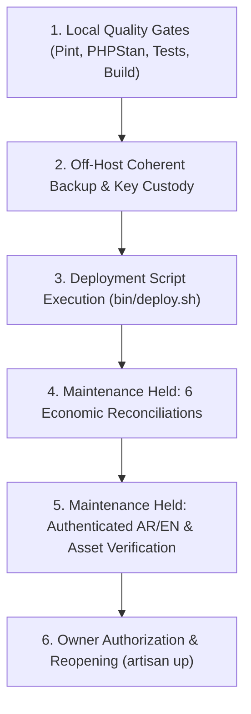

# Small Trader Accounting — Release & Orchestration Guide

**Target Application:** Small Trader Accounting (`account.palsync.net`)  
**Repository:** `https://github.com/Bassamalsaqqa/account`  
**Companion Mobile Repository:** [Bassamalsaqqa/small-trader-android](https://github.com/Bassamalsaqqa/small-trader-android)  
**Authoritative Operational Guides:** [CONTROLLED_RELEASE_CHECKLIST.md](CONTROLLED_RELEASE_CHECKLIST.md) and [HOSTINGER_DEPLOYMENT_GUIDE.md](HOSTINGER_DEPLOYMENT_GUIDE.md)

---

## 1. Scope, Purpose & Operational Authority

This document serves as the minimal, central entrypoint for backend release orchestration, version numbering conventions, build manifest generation, mobile client API compatibility tracking, and release-note authoring.

> [!IMPORTANT]
> **Operational Execution Authority & Production Safety:**  
> Preparing release documentation, checksum inventories, release notes, or deployment commands **does NOT grant authorization to execute production actions**. Every production code merge, Hostinger deployment, schema migration, or maintenance reopening requires explicit, prior Owner review and written authorization.
> 
> Operational execution procedures are governed authoritatively by:
> - [docs/CONTROLLED_RELEASE_CHECKLIST.md](CONTROLLED_RELEASE_CHECKLIST.md) (Fail-closed release gates and reopening protocol)
> - [docs/HOSTINGER_DEPLOYMENT_GUIDE.md](HOSTINGER_DEPLOYMENT_GUIDE.md) (Hostinger production filesystem layout and deployment script usage)
> - [docs/PHASE_10_BACKUP_RESTORE_RUNBOOK.md](PHASE_10_BACKUP_RESTORE_RUNBOOK.md) (Coherent backup and disaster recovery procedures)

This guide defines the orchestration rules and cross-repository synchronization points without duplicating operational steps.

---

## 2. Versioning & Git Tag Conventions

### 2.1 Backend Repository (`account`)
The backend adheres to Semantic Versioning (`vMAJOR.MINOR.PATCH`):
- **Tag Format:** `vX.Y.Z` (e.g., example `v0.1.0-pilot.1` for pre-release pilot increments, progressing to `v0.1.0` upon formal general availability; these version strings are illustrative examples and do NOT constitute a claim that these versions have been released).
- **Independent Cadence:** The backend repository and Android client repository maintain **independent release cadences**. They do NOT move in lockstep.
- **Tag Creation Custody:** Git tags are never created automatically or speculatively during feature development. Tags are annotated and created by the repository owner only upon formal release approval.

### 2.2 Companion Android Client (`small-trader-android`) Boundary
The companion Android repository owns its application versioning and upgrade lifecycle independently:
- **`versionName`:** Standard SemVer string **without** leading `v` (e.g., `0.1.0-pilot.1`, `0.1.0`).
- **`versionCode`:** Strictly monotonic positive integer incremented with every distributed build (e.g., `10001`, `10002`).
- **Application ID & Signing Key:** Immutable `applicationId` (`net.palsync.smalltrader`) and release signing keystore custody remain exclusively with the Android maintainer.
- **In-Place Upgrades:** Updates are installed strictly in-place over existing installations. Uninstallation is prohibited because it deletes local Room database drafts and outbox transaction queues.
- **Android Release Guide:** Consult the companion Android documentation at [https://github.com/Bassamalsaqqa/small-trader-android/blob/main/docs/RELEASING.md](https://github.com/Bassamalsaqqa/small-trader-android/blob/main/docs/RELEASING.md).

---

## 3. Source SHA & Build Manifest Inventory

Every release candidate must be strictly tied to an exact source commit SHA and reproducible build artifacts produced using locked dependencies.

### 3.1 Repeatable Build Commands
All dependencies and build artifacts must be generated strictly from locked configurations:

```bash
# 1. Verify clean git working tree and record exact source commit SHA
git rev-parse HEAD

# 2. Install locked PHP production dependencies under verified PHP 8.4
composer install --no-dev --prefer-dist --optimize-autoloader --no-interaction

# 3. Install locked Node dependencies and compile production frontend bundle
npm ci
npm run build
```

### 3.2 Build Inventory & Integrity Constraints
Before staging any build for production:
1. **Manifest File:** `public/build/manifest.json` must exist and be recorded with its SHA256 checksum.
2. **Asset Checksums:** Record SHA256 checksums for all entrypoint CSS, JS, and vendor chunks referenced in `manifest.json`.
3. **No Source Maps:** Production builds must be source-map free. Confirm that no `.map` files exist in `public/build/`.
4. **File Permissions:** Enforce strict permissions across all build artifacts:
   - Directories: `0755` (`drwxr-xr-x`)
   - Files: `0644` (`-rw-r--r--`)
   - Never set `0777` permissions.
5. **Static Root Assets:** Verify non-build static assets at the public root (`manifest.webmanifest`, `sw.js`, `offline.html`, `favicon.svg`, icons directory).

---

## 4. Production Architecture & Deployment Safety Invariants

### 4.1 Hostinger Filesystem Layout
The target environment on Hostinger Shared Hosting (`account.palsync.net`) enforces strict separation between private code and public serving directories:

- **Private Application Root:** `/home/u556956644/domains/palsync.net/accounting` (contains `.env`, `app/`, `vendor/`, `storage/`, `artisan`).
- **Public Document Root:** `/home/u556956644/domains/palsync.net/public_html/account` (contains `index.php`, `.htaccess`, `manifest.webmanifest`, `build/`).

> [!WARNING]
> **No Symlinked Public Roots & Preserved Document Root:**  
> The approved document root layout is fixed. Public-root symbolic links are strictly prohibited and rejected by `bin/deploy.sh` because they cannot prove custody and can expose premature checkout changes. Do not modify DNS records, move directory roots, or attempt symlink cleanups.

### 4.2 Inode Bound Preservation & Atomic Asset Replacement
- Hostinger inode quotas are strictly bounded.
- `bin/deploy.sh` stages complete, manifest-verified build directories and executes atomic same-filesystem directory renames (`mv`).
- Never overlay newly hashed chunks on top of old build directories.

### 4.3 Coherent Backup & Key Custody
Before any source change or asset transfer:
1. **Full Coherent Backup:** Create a full MySQL transaction dump and consistent snapshot of private application files, public uploads, and active `.htaccess`.
2. **Off-Host Recovery Custody:** Transfer encrypted or restricted backup archives to verified off-host custody (e.g., `/home/t3dev/.t3/private-release-backups/`).
3. **Key Custody Separation:** Application encryption keys (`APP_KEY`) and backup decryption keys must be preserved in separate restricted custody (`0700` directories, `0600` files).
4. **No Secrets in Output:** Never print environment variables, database credentials, or secret keys into build logs, Git commits, or shared documentation evidence.

### 4.4 Non-Destructive Rollback & Forward-Schema Policy
- **Forward-Only Migrations:** Database migrations applied in production are strictly forward-compatible.
- **No Blind Reversals:** Never run `artisan migrate:rollback` or `artisan migrate:fresh` against production. Schema corrections must be packaged as audited forward migrations.
- **No Overwriting SQL Restores:** Never restore an older database snapshot over subsequent production activity. In an active double-entry accounting system, overwriting tables destroys real financial transactions, customer invoices, payments, sequential voucher numbers, and immutable audit logs.

---

## 5. API & Mobile Client Compatibility Matrix

### 5.1 Release Sequence Rule
When deploying features that involve both backend API endpoints and mobile client updates:
1. **API First:** The backend API changes and forward database migrations must be deployed, verified, and stabilized in production **before** distributing any dependent Android APK.
2. **Backward Compatibility Required:** The deployed backend API must remain fully backward-compatible with previously deployed pilot APK versions.

### 5.2 Compatibility & Pilot Readiness Matrix
The following table documents the compatibility status across backend releases, mobile contract specifications, and APK builds.

| Backend Tag / Commit SHA | API Contract Spec | Compatible APK `versionName` (`versionCode`) | Previous Pilot APK Support | Tested Endpoint Coverage | Pilot / Operational Status |
|---|---|---|---|---|---|
| `8362c15` / `f8a0cf7` (Current Production) | Contract Rev 1 | N/A (Web PWA only) | N/A | Web routes & PWA manifest | **LIVE IN PRODUCTION** (PR 85) |
| *Candidate* (Baseline + PR 88) | Native Mobile Auth Slice 2 | `0.1.0-pilot.1` (`10001`) *(proposed)* | Baseline compatibility verified | `/api/v1/auth/token`, `/api/v1/user/profile` | **DRAFT / IN REVIEW** (PR 88; NOT pilot ready) |
| *Candidate* (Baseline + PR 86 / PR 89) | Mobile Contract Rev 2 | `0.1.0-pilot.2` *(proposed)* | Requires testing against Rev 1 payloads | `/api/v1/export/company-data` | **DRAFT SPECIFICATION** (Additive; NOT financial ready) |

> [!CAUTION]
> **Honest Operational Status:**  
> - Native mobile authentication (PR 88) and contract revision 2 (PR 86, PR 89) are currently in active draft / code review.  
> - **They are NOT merged, NOT deployed, and NOT pilot-ready in production.**  
> - Offline synchronization and offline financial mutations remain strictly **POLICY OFF**. No client-side offline journal or financial writes are authorized.  
> - Do not claim or assume runtime mobile integration exists until explicitly qualified and approved by the Owner.

---

## 6. Private Pilot Release Verification Gates

Prior to releasing a new version for a private pilot, operators must verify each quality gate in sequence. Untested gates must be documented truthfully as UNTESTED.



### Gate 1: Source & Build Qualification
- [ ] Working tree clean, exact commit SHA recorded: `git rev-parse HEAD`.
- [ ] Linting and static analysis pass: `vendor/bin/pint --test` and `vendor/bin/phpstan analyse`.
- [ ] Relevant test suites pass without regression: `php artisan test`.
- [ ] Fresh production build generated: `npm ci && npm run build`.
- [ ] Build manifest recorded with SHA256 checksum; no source maps present.

### Gate 2: Pre-Deployment Backup Custody
- [ ] Coherent SQL transaction dump and file archive created.
- [ ] Transferred to off-host backup custody location outside the web root.
- [ ] Encryption keys and credentials verified in restricted custody (0600/0700).

### Gate 3: Deployment Preparation under Maintenance
- [ ] Application placed in maintenance mode using deployed code (`artisan down --retry=60 --render="errors.503"`).
- [ ] Run `bin/deploy.sh` under verified PHP 8.4 runtime:
  ```bash
  PHP_BIN=/opt/alt/php84/usr/bin/php ./bin/deploy.sh
  ```
- [ ] Live `.htaccess` byte-for-byte custody verified.
- [ ] Assets atomically published to `public_html/account/build/`.
- [ ] Maintenance mode confirmed **HELD**.

### Gate 4: Read-Only Economic Reconciliations
Execute the six canonical reconciliation domains across all tenant companies via CLI / read-only service harness:
- [ ] `php artisan accounting:reconcile` (General Ledger integrity)
- [ ] `php artisan inventory:reconcile` (Stock batches, FEFO, lot allocations)
- [ ] `php artisan sales:reconcile` (Sales invoices, payments, AR subledger)
- [ ] `php artisan money:reconcile` (Cash registers, bank accounts, checks)
- [ ] `php artisan phase7:reconcile` (Treasury and multi-currency reconciliations)
- [ ] `PayablesReconciliationService` via read-only harness (Vendor balances, AP subledger)
*All six reconciliation passes must report 0 imbalances or data discrepancies.*

### Gate 5: Authenticated Session & Asset Verification
Through the authorized maintenance bypass:
- [ ] Authenticated dashboard renders HTTP 200 in Arabic (RTL) and English (LTR).
- [ ] Livewire 4 and Alpine.js initialize cleanly without browser console errors.
- [ ] Sales invoice and Purchase creation workflows render with correct field density.
- [ ] Web app manifest resolves at `https://account.palsync.net/manifest.webmanifest` with `application/manifest+json`.
- [ ] Error logs in `storage/logs/laravel.log` inspected; zero unhandled exceptions.

### Gate 6: Owner Authorization & Reopening
- [ ] Verification summary presented to Owner.
- [ ] Written authorization obtained from Owner.
- [ ] Bring application online:
  ```bash
  /opt/alt/php84/usr/bin/php artisan up
  ```
- [ ] Confirm public HTTP 200 on login screen.

---

## 7. Standard Release Note Template

When preparing a release, complete the following structured release note template and record it in `docs/evidence/` or the release PR description:

```markdown
# Release Note: Small Trader Accounting [vX.Y.Z-pilot.N / vX.Y.Z]

- **Release Date:** YYYY-MM-DD
- **Target Environment:** Hostinger Production (`account.palsync.net`)
- **Git Commit SHA:** `<40-character-sha>`
- **Previous Deployed SHA:** `<40-character-sha>`
- **Release PR:** https://github.com/Bassamalsaqqa/account/pull/<PR-NUMBER>

## 1. Summary of Changes
- [Brief bullet points describing user-facing improvements or critical fixes]
- [Architectural or database schema changes, if applicable]

## 2. Build & Manifest Inventory
- **Composer Lock Checksum:** `<sha256-of-composer.lock>`
- **Package Lock Checksum:** `<sha256-of-package-lock.json>`
- **Vite Build Manifest SHA256:** `<sha256-of-manifest.json>`
- **Source Maps:** Verified ABSENT (0 .map files)
- **Asset Permissions:** Directories 0755 / Files 0644

## 3. Database & Migration Record
- **Migrations Run:** [None / List migration batch numbers and names]
- **Bootstrap Run:** [None / purchasing / documents]
- **Forward-Schema Invariant:** Preserved (no destructive rollback required)

## 4. Mobile Client API Compatibility
- **API Contract Level:** [e.g. Contract Rev 1]
- **Compatible Android APKs:** [e.g. None / versionName 0.1.0-pilot.1 (versionCode 10001)]
- **Previous APK Backward Compatibility:** [Verified PASS / N/A]
- **Offline Sync Status:** Strictly OFF

## 5. Economic Reconciliations & Quality Gates
- **Accounting Reconciliation:** PASS (0 discrepancies)
- **Inventory Reconciliation:** PASS (0 discrepancies)
- **Sales Reconciliation:** PASS (0 discrepancies)
- **Payables Reconciliation:** PASS (0 discrepancies)
- **Money Reconciliation:** PASS (0 discrepancies)
- **Phase 7 Reconciliation:** PASS (0 discrepancies)
- **Error Log Status:** Clean (0 unhandled exceptions)

## 6. Backup & Rollback Custody
- **Off-Host Backup Path:** `/home/t3dev/.t3/private-release-backups/release-<timestamp>-<sha>/`
- **Key Custody Path:** `/home/t3dev/.t3/private-release-key-custody/release-<timestamp>-<sha>/`
- **Known-Good Rollback Target:** Commit `<rollback-sha>`

## 7. Owner Signoff & Execution
- **Deployment Script:** `bin/deploy.sh` executed under PHP 8.4
- **Reopening Authorized By:** Bassam Alsaqqa (Owner)
- **Reopened At:** YYYY-MM-DD HH:MM UTC
```
