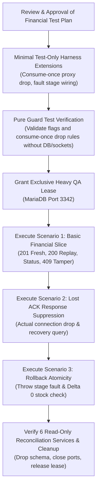

# PR #102 Disposable Financial Execution Test Plan

**PR**: [#102](https://github.com/Bassamalsaqqa/account/pull/102) (`t3/recover-cash-writer`)  
**Repository**: `Bassamalsaqqa/account`  
**Document Status**: **SOURCE-ONLY PLAN** (No implementation, no listeners, no DB sockets, no heavy QA, no financial network requests).  
**Execution Target**: Disposable MariaDB (Port 3342) under exclusive heavy QA lease when explicitly granted.  
**Accepted Core Invariant Base**: `6981511405d7bcd04cd8f8a09e64443ce0aaf47e` (0-byte diff on `app/`, `routes/`, `config/`, `composer.lock`).  
**Client Handoff Schema Digest**: `edaef0309765e10d6462b36b5c660eb02f65c057c810ab72f756f7664e3ca275`.  
**Future Pairing Manifest Target Pins**:
- Backend Baseline HEAD: `3b49d7dfd4c6300e70920f6a68600d132e4cdfcc` (or latest documentation commit)
- Peer Android Publication HEAD: `6bc22542500ecb0dae5ad99246e82982dcef680f`
- Peer Android Executable HEAD: `78ac4437e4010b68408278788dc82eb826fe8014`
- Authorized Scope: Existing **`ROOT_AUTHORIZED_PAIRED_EXECUTION`** (`DisposableMobileV2BackendHarness::SCOPE_PAIRED_EXECUTION`) via existing CLI command flag **`--run`**. Zero invented scopes or flags.

---

## 1. Executive Summary & Review Intent

Following the successful Root-coordinated paired readiness attestation (Run 5 `ooug5prl`, exit code 0, 2 tests PASS), this document specifies the concrete, reviewable, source-first test plan for **disposable native financial execution** on Mobile V2.

In strict adherence to the Outer Financial Acceptance Criteria:
- **Basic HTTP smoke alone is strictly insufficient for pilot acceptance**.
- Full pilot qualification **must require each required critical scenario to PASS separately**:
  1. Fresh online cash commit (201).
  2. Idempotent exact replay (200).
  3. Status query parity (200 with 6-field official invoice subset).
  4. Client event ID tamper conflict rejection (409).
  5. **Lost ACK Recovery**: Verified response suppression after commit with client reconnection and status reconciliation.
  6. **Atomicity & Rollback**: Named throw-only fault injection verifying zero delta against baseline.
  7. **Negative Boundaries**: Tenant mismatch, missing permissions, revoked tokens, insufficient inventory.
- Next minimal basic financial case is separate from pending lost ACK / rollback; zero claims of complete core qualification without bounded execution proof.

---

## 2. Architecture & Existing Primitives Inspection

Inspection of the codebase confirms that all core financial execution primitives, transactional lock sequences, and fault injection stages **already exist** in source:

### 2.1 Existing Execution Primitives
| Component | File Path | Existing Capabilities |
|---|---|---|
| `ExecuteImmediateOnlineCashSaleAction` | `app/Actions/Sales/ExecuteImmediateOnlineCashSaleAction.php` | Atomically executes Leg 1 (draft), Leg 2 (post + numbering + FEFO lot deduction + GL), Leg 3 (payment + numbering + 100% allocation). Locks Company root row (`lockForUpdate`), verifies permissions under lock, enforces strict stock. |
| `QualifiedCashFinancialExecutionAdapter` | `tests/Support/QualifiedCashFinancialExecutionAdapter.php` | Test-only adapter implementing `FinancialExecutionAdapterInterface`. Scopes Spatie permissions to tenant team, asserts granular permissions (`sales.invoice.create`, `sales.invoice.post`, `money.receipt.create`, `money.receipt.allocate`), requires `NativeFinancialExecutionCapability`. Production binding remains `DenyFinancialExecutionAdapter`. |
| Existing Named Fault Injection Stages | `ExecuteImmediateOnlineCashSaleAction::$simulatedFaultStage` (lines 56–70) | Throw-only named stage mechanism: `after_draft` (line 414), `after_posting` (line 418), `after_payment` (line 456), `after_composite_completion` (line 467). Strictly throw-only in `testing` environment; no caller code or arbitrary callbacks. |
| Child HTTP Bootstrap Binding | `DisposableMobileV2BackendHarness.php` (lines 964–990) | Child `php -S` process already binds `QualifiedCashFinancialExecutionAdapter::class` upon framework boot when MariaDB port 3342 is verified. When authorized under existing scope `ROOT_AUTHORIZED_PAIRED_EXECUTION`, financial routes flow directly to the Laravel kernel. |

---

## 3. What Already Exists vs What Minimal Test-Only Implementation Is Needed

| Area | Already Exists in Codebase | Minimal Test-Only Implementation Needed |
|---|---|---|
| **Domain Logic** | Full 3-leg cash sale execution, FEFO inventory ledger, GL transactions, Company-root row lock. | **None**. Production/core domain code is complete and frozen. |
| **Transport & CLI** | Existing `--run` command and existing scope `ROOT_AUTHORIZED_PAIRED_EXECUTION`. | **None**. Transport and scope primitives already exist in `DisposableMobileV2BackendHarness.php`. |
| **Fault Injection** | `ExecuteImmediateOnlineCashSaleAction::$simulatedFaultStage` with 4 throw stages (`after_draft`, `after_posting`, `after_payment`, `after_composite_completion`). | Wire CLI parameter `--simulate-fault-stage=<stage>` to child env in test harness. |
| **Lost ACK Control** | Unit-level replay test in `OnlineCashSaleQualificationTest.php`. | **Reviewable Test Proxy Filter**: `php -S` behind Caddy cannot promise clean TCP termination from PHP `exit` (Caddy may return 502 Bad Gateway or empty body, which alone is not proof). Harness requires a test proxy control that suppresses the completed client ACK **after independently verifying that the commit transaction succeeded in MariaDB**. Control must be **consume-once on the targeted client event ID**, so subsequent recovery replays/status queries succeed without being dropped. |
| **Pure Guard Tests** | 57 pure tests verifying readiness router, pcntl, certs, permissions. | Add pure guard tests asserting validation of fault stage parameter and consume-once drop control. |

---

## 4. Finite Test Scenarios Specification

### Scenario 1: Minimal Next Concrete Case — Basic Financial Slice
This is the minimal next concrete scenario to qualify before executing lost ACK and rollback drills.

#### Step 1.1: Fresh Online Cash Sale Commit (HTTP 201)
- **Endpoint**: `POST /api/mobile/v2/companies/{companyId}/sales/online-cash`
- **Headers**: `Authorization: Bearer <mobile_access_token>`, `Content-Type: application/json`
- **Payload**: Authoritative synthetic request template matching canonical JCS wire digest:
  - `client_event_id`: Normative version-agnostic UUID layout (`[0-9a-fA-F]{8}-[0-9a-fA-F]{4}-[0-9a-fA-F]{4}-[0-9a-fA-F]{4}-[0-9a-fA-F]{12}`); fixture generates v4.
  - `device_id`: Enrolled mobile device UUID
  - `customer_id`: Seeded customer ULID
  - `warehouse_id`: Seeded warehouse ULID
  - `currency`: `'ILS'`
  - `lines`: 1 item, quantity `1.000000`, unit price `50.000000`, tax rate `16.000000` (exclusive), line total `58.000000`
  - `payment`: `settlement_mode: 'full'`, `payment_method: 'cash'`, `amount: '58.000000'`
- **Expected Wire Response (10 Keys, HTTP 201)**:
  ```json
  {
    "client_event_id": "c0686be5-888f-4890-90bf-1f05f416a19a",
    "status": "posted",
    "invoice_id": "<ULID>",
    "invoice_number": "INV-...",
    "payment_id": "<ULID>",
    "payment_receipt_number": "REC-...",
    "grand_total": "58.000000",
    "amount_paid": "58.000000",
    "change_returned": "0.000000",
    "posted_at": "<ISO-8601>"
  }
  ```

#### Step 1.2: Idempotent Exact Replay (HTTP 200)
- **Action**: Repeat identical request with same `client_event_id` and wire payload.
- **Expected Response**: HTTP 200 with byte-identical 10-key JSON body.
- **Database Parity Assertion**: Count of `sales_invoices`, `customer_payments`, `customer_payment_allocations`, `stock_movements`, and `mobile_event_receipts` must be identical before and after replay (zero duplication).

#### Step 1.3: Event Status Query (HTTP 200)
- **Endpoint**: `GET /api/mobile/v2/companies/{companyId}/offline-events/{clientEventId}/status`
- **Expected Response (6-field subset in official_invoice, HTTP 200)**:
  ```json
  {
    "client_event_id": "c0686be5-888f-4890-90bf-1f05f416a19a",
    "company_id": "01M7CZPF6TP283F3ZRXF5P8GT2",
    "status": "posted",
    "payload_digest": "sha256:...",
    "official_invoice": {
      "invoice_id": "<ULID>",
      "invoice_number": "INV-...",
      "payment_id": "<ULID>",
      "payment_receipt_number": "REC-...",
      "grand_total": "58.000000",
      "posted_at": "<ISO-8601>"
    },
    "conflict": null,
    "queried_at": "<ISO-8601>"
  }
  ```
- **Parity Assertion**: Assert matching `invoice_id`, `payment_id`, `invoice_number`, `payment_receipt_number`, and `grand_total` between commit DTO and status query DTO.

#### Step 1.4: Tamper Conflict Rejection (HTTP 409)
- **Action**: Submit duplicate `client_event_id` with modified payment amount (`59.000000`) or altered product ID.
- **Expected Response**: HTTP 409 Conflict with error code `CONFLICT` (`DuplicateEventException` mapped in `OnlineCashSaleController.php:117-121`). Zero state modification.

#### Step 1.5: Six Read-Only Reconciliation Services & Methods
Following commit, invoke the 6 canonical read-only reconciliation services directly from the reviewed helper (`tests/Support/Phase7/financial-scenarios.php:103-105`):
1. `App\Services\Accounting\AccountingReconciliationService::reconcile(Company $company)`: Verifies double-entry balanced batches and ledger consistency.
2. `App\Services\Inventory\InventoryReconciliationService::auditCompany(Company $company)`: Verifies inventory lot balances, warehouse stock, and reports 0 discrepancies.
3. `App\Services\Sales\SalesReconciliationService::reconcile(Company $company)`: Verifies sales invoice line integrity and payment allocations.
4. `App\Services\Purchasing\PayablesReconciliationService::reconcile(Company $company)`: Verifies purchase ledger remains unaffected.
5. `App\Services\Money\MoneyReconciliationService::reconcile(Company $company)`: Verifies customer payments, receipts, and cash money accounts.
6. `App\Services\Accounting\Phase7ReconciliationService::reconcile(Company $company)`: Verifies multi-ledger integration rules.

---

### Scenario 2: Critical Scenario — Lost ACK Response Suppression Recovery
- **Failure Model**: The backend successfully commits all 3 legs and receipt in MariaDB, but the network disconnects before the HTTP 201 response reaches the client.
- **Harness Control**: Test proxy control intercepts response for targeted `client_event_id`. It verifies that the `MobileEventReceipt` exists in MariaDB with status `posted`, then suppresses the response bytes.
- **Consume-Once Invariant**: The suppression rule triggers exactly once for that `client_event_id` and is immediately consumed.
- **Client Recovery**: Client encounters connection timeout/drop, marks transaction as pending, and issues status query `GET /.../offline-events/{clientEventId}/status` (or idempotent replay POST).
- **Assertions**:
  - Client receives HTTP 200 with matching official invoice/payment public ULIDs.
  - MariaDB verification: Zero duplicate invoices, payments, or receipts created.

---

### Scenario 3: Critical Scenario — Atomicity & Rollback via Named Throw Stages
- **Failure Model**: Mid-transaction failure occurs during multi-leg financial execution.
- **Harness Control**: Set `--simulate-fault-stage=after_posting` (or `after_payment`).
- **Baseline Invariant**: The seeded MariaDB schema already contains baseline `StockMovement` records from initial inventory lot creation.
- **Verification Assertions**:
  - Endpoint returns HTTP 500 (handled via transaction failure).
  - **StockMovement Delta = 0**: Pre-run and post-rollback `StockMovement` counts and row fingerprints are identical (zero new movements created).
  - Sequential invoice and receipt numbering counters roll back to pre-test baseline.
  - GL posting batches and lines roll back to pre-test baseline.
  - FEFO lot allocations, customer payments, sales invoices, and receipts roll back to pre-test baseline.
  - Zero leaked locks on Company root or inventory balance rows.

---

### Scenario 4: Negative Boundary Cases & Isolation Safeguards
To ensure that negative permission drills do not contaminate remaining test cases, negative boundary cases run against an **isolated fresh owned fixture / baseline**:

1. **Role Fixture Assignment**:
   - The test actor receives Manager permissions canonically via role assignment (`$actor->assignRole('Manager')` via `CompanyRoleService::seedCompanyRoles($company)`).
   - Negative permission drills test the removal of the inherited role grant (`$actor->removeRole('Manager')`), rather than relying solely on direct permission overrides.
2. **Missing Create Permission**: Actor without `sales.invoice.create` -> returns HTTP 403 Forbidden (`AuthorizationException` mapped in `OnlineCashSaleController.php:128-133`).
3. **Foreign Tenant Access**: Actor attempting commit for foreign company ID -> returns HTTP 403 Forbidden (`AuthorizationException`).
4. **Revoked Device Session**: Mobile device marked inactive or un-enrolled -> returns HTTP 401 Unauthenticated via Sanctum authentication guard.
5. **Negative Stock Prevention**: Requesting quantity exceeding available inventory -> returns HTTP 422 Unprocessable Entity (`InvalidInventoryMovementException` mapped in `OnlineCashSaleController.php:122-127`).

---

## 5. Execution Prerequisites & Safeguards

Before any live financial execution can be authorized:
1. **Exclusive Heavy QA Lease**: Exclusive lease must be granted on MariaDB port 3342.
2. **Root-Authorized Scope**: Runtime pairing manifest must declare existing `ROOT_AUTHORIZED_PAIRED_EXECUTION` pinned with deterministic SHA-256 digest (not a signature).
3. **Fresh Ephemeral Schema**: Dedicated disposable schema `accounting_p8_tmp_<hex12>` created with fresh migrations and canonical seed data.
4. **Guaranteed Bounded Cleanup**:
   - Schema dropped in `finally` block.
   - Temporary directory deleted.
   - Loopback (`18080`) and TLS proxy (`18443`) ports closed (verified via Python `socket.connect_ex`).
5. **Core Application Invariance Preserved**: Zero changes to `app/`, `routes/`, `config/`, or `composer.lock`.

---

## 6. Implementation Sequence (Next Steps When Authorized)


