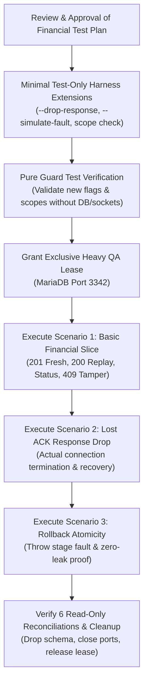

# PR #102 Disposable Financial Execution Test Plan

**PR**: [#102](https://github.com/Bassamalsaqqa/account/pull/102) (`t3/recover-cash-writer`)  
**Repository**: `Bassamalsaqqa/account`  
**Document Status**: **SOURCE-ONLY PLAN** (No implementation, no listeners, no DB sockets, no heavy QA, no financial network requests).  
**Execution Target**: Disposable MariaDB (Port 3342) under exclusive QA lease when authorized.  
**Accepted Core Invariant**: `6981511405d7bcd04cd8f8a09e64443ce0aaf47e` (0-byte diff on core paths).  
**Lifecycle Scope Prerequisite**: `ROOT_AUTHORIZED_FINANCIAL_PILOT`.

---

## 1. Executive Summary & Review Intent

Following the successful Root-coordinated paired readiness attestation (Run 5 `ooug5prl`, exit code 0, 2 tests PASS), this document specifies the concrete, reviewable, source-first test plan for **disposable native financial execution** on Mobile V2.

In strict adherence to the Outer Financial Acceptance Criteria:
- **Basic HTTP smoke alone is strictly insufficient for pilot acceptance**.
- Full pilot qualification **must require each required critical scenario to PASS separately**:
  1. Fresh online cash commit (201).
  2. Idempotent exact replay (200).
  3. Status query parity (200 with 6-field official invoice subset).
  4. Client event ID tamper conflict rejection (409).
  5. **Lost ACK Recovery**: Actual server response-drop-after-commit (server completes transaction, drops HTTP response, client recovers via replay/status).
  6. **Atomicity & Rollback**: Named throw-only fault injection verifying zero orphaned records.
  7. **Negative Boundaries**: Tenant mismatch, missing permissions, revoked tokens, insufficient inventory.

---

## 2. Architecture & Existing Primitives Inspection

Inspection of the codebase confirms that all core financial execution primitives, transactional lock sequences, and fault injection stages **already exist** in source:

### 2.1 Existing Execution Primitives
| Component | File Path | Existing Capabilities |
|---|---|---|
| `ExecuteImmediateOnlineCashSaleAction` | `app/Actions/Sales/ExecuteImmediateOnlineCashSaleAction.php` | Atomically executes Leg 1 (draft), Leg 2 (post + numbering + FEFO lot deduction + GL), Leg 3 (payment + numbering + 100% allocation). Locks Company root row (`lockForUpdate`), verifies permissions under lock, enforces strict stock. |
| `QualifiedCashFinancialExecutionAdapter` | `tests/Support/QualifiedCashFinancialExecutionAdapter.php` | Test-only adapter implementing `FinancialExecutionAdapterInterface`. Scopes Spatie permissions to tenant team, asserts granular permissions (`sales.invoice.create`, `sales.invoice.post`, `money.receipt.create`, `money.receipt.allocate`), requires `NativeFinancialExecutionCapability`. Production binding remains `DenyFinancialExecutionAdapter`. |
| Existing Named Fault Injection Stages | `ExecuteImmediateOnlineCashSaleAction::$simulatedFaultStage` (lines 56–70) | Throw-only named stage mechanism: `after_draft` (line 414), `after_posting` (line 418), `after_payment` (line 456), `after_composite_completion` (line 467). Strictly throw-only in `testing` environment; no caller code or arbitrary callbacks. |
| Child HTTP Bootstrap Binding | `DisposableMobileV2BackendHarness.php` (lines 964–990) | Child `php -S` process already binds `QualifiedCashFinancialExecutionAdapter::class` upon framework boot when MariaDB port 3342 is verified. In readiness-only mode, the child router returns 403; in financial mode, requests flow to Laravel kernel. |

---

## 3. What Already Exists vs What Minimal Test-Only Implementation Is Needed

| Area | Already Exists in Codebase | Minimal Test-Only Implementation Needed |
|---|---|---|
| **Domain Logic** | Full 3-leg cash sale execution, FEFO inventory ledger, GL transactions, Company-root row lock. | **None**. Production/core domain code is complete and frozen. |
| **Fault Injection** | `ExecuteImmediateOnlineCashSaleAction::$simulatedFaultStage` with 4 throw stages. | Minor CLI flag (`--simulate-fault-stage=<stage>`) in `mobile-v2-harness-cli.php` to wire to child env. |
| **Lost ACK Control** | In-memory unit test in `OnlineCashSaleQualificationTest.php`. | **Actual response drop control**: CLI flag `--drop-response-after-commit=<clientEventId>` in harness child router to close HTTP connection immediately after DB commit, triggering realistic client network drop. |
| **Lifecycle Scope** | `ROOT_AUTHORIZED_READINESS_ONLY` enforced fail-closed. | Add `ROOT_AUTHORIZED_FINANCIAL_PILOT` to `DisposableMobileV2BackendHarness::assertLifecycleScope()`. |
| **Harness CLI** | Standalone `--prepare`, `--provision`, `--run --readiness-only`. | Add `--financial-pilot` flag to `MobileV2HarnessCommand` and `mobile-v2-harness-cli.php`. |
| **Pure Guard Tests** | 57 pure tests verifying readiness router, pcntl, certs, permissions. | Add pure tests asserting financial scope validation, drop-response flag validation, and fault-stage gating. |

---

## 4. Finite Test Scenarios Specification

### Scenario 1: Minimal Next Concrete Case — Basic Financial Slice
This is the minimal next concrete scenario to qualify before multi-client concurrency.

#### Step 1.1: Fresh Online Cash Sale Commit (HTTP 201)
- **Endpoint**: `POST /api/mobile/v2/companies/{companyId}/sales/online-cash`
- **Headers**: `Authorization: Bearer <mobile_access_token>`, `Content-Type: application/json`
- **Payload**: Authoritative synthetic request template matching canonical JCS wire digest:
  - `client_event_id`: Fresh UUIDv4 (`c0686be5-...`)
  - `device_id`: Enrolled mobile device UUID
  - `customer_id`: Seeded customer ULID
  - `warehouse_id`: Seeded warehouse ULID
  - `currency`: `'ILS'`
  - `lines`: 1 item, quantity `1.000000`, unit price `50.000000`, tax rate `16.000000` (exclusive), line total `58.000000`
  - `payment`: `settlement_mode: 'full'`, `payment_method: 'cash'`, `amount: '58.000000'`
- **Expected Wire Response (10 Keys, HTTP 201)**:
  ```json
  {
    "client_event_id": "c0686be5-888f-4890-90bf-1f05f416a19a",
    "status": "posted",
    "invoice_id": "<ULID>",
    "invoice_number": "INV-...",
    "payment_id": "<ULID>",
    "payment_receipt_number": "REC-...",
    "grand_total": "58.000000",
    "amount_paid": "58.000000",
    "change_returned": "0.000000",
    "posted_at": "<ISO-8601>"
  }
  ```

#### Step 1.2: Idempotent Exact Replay (HTTP 200)
- **Action**: Repeat identical request with same `client_event_id` and wire payload.
- **Expected Response**: HTTP 200 with byte-identical 10-key JSON body.
- **Database Parity Assertion**: Count of `sales_invoices`, `customer_payments`, `customer_payment_allocations`, `stock_movements`, and `mobile_event_receipts` must be identical before and after replay (zero duplication).

#### Step 1.3: Event Status Query (HTTP 200)
- **Endpoint**: `GET /api/mobile/v2/companies/{companyId}/offline-events/{clientEventId}/status`
- **Expected Response (6-field subset in official_invoice, HTTP 200)**:
  ```json
  {
    "client_event_id": "c0686be5-888f-4890-90bf-1f05f416a19a",
    "company_id": "01M7CZPF6TP283F3ZRXF5P8GT2",
    "status": "posted",
    "payload_digest": "sha256:...",
    "official_invoice": {
      "invoice_id": "<ULID>",
      "invoice_number": "INV-...",
      "payment_id": "<ULID>",
      "payment_receipt_number": "REC-...",
      "grand_total": "58.000000",
      "posted_at": "<ISO-8601>"
    },
    "conflict": null,
    "queried_at": "<ISO-8601>"
  }
  ```
- **Parity Assertion**: Assert matching `invoice_id`, `payment_id`, `invoice_number`, `payment_receipt_number`, and `grand_total` between commit DTO and status query DTO.

#### Step 1.4: Tamper Conflict Rejection (HTTP 409)
- **Action**: Submit duplicate `client_event_id` with modified payment amount (`59.000000`) or altered product ID.
- **Expected Response**: HTTP 409 Conflict with error code `event_payload_conflict`. Zero state modification.

#### Step 1.5: Six Read-Only Domain Reconciliations
Following commit, verify directly in MariaDB under the owned schema:
1. **SalesInvoice**: Record exists with status `posted`, matching tenant `company_id`, customer, currency, total `58.000000`, and sequential numbering.
2. **CustomerPayment**: Record exists with status `posted`, `payment_method = 'cash'`, non-null `cash_account_id`, amount `58.000000`.
3. **CustomerPaymentAllocation**: Exactly 1 allocation binding the payment to the invoice with allocated amount `58.000000` (100% reconciliation; zero remaining balance).
4. **StockMovement**: Physical inventory ledger deduction in base units recorded for product and warehouse. Inventory balance correctly reduced.
5. **MobileEventReceipt**: Single receipt record with client UUID identity (`client_event_id`), verified sequentially numbered without duplicates.
6. **General Ledger Journal**: Balanced double-entry transactions posted (Debit Cash Account 58.00, Credit Sales Revenue 50.00, Credit Tax Liability 8.00).

---

### Scenario 2: Critical Scenario — Lost ACK Response Drop Recovery
- **Failure Model**: The backend successfully commits all 3 legs and receipt in MariaDB, but a network disconnect occurs before the HTTP response reaches the client.
- **Harness Control**: Set `--drop-response-after-commit=c0686be5-...`. The harness child router executes the full commit transaction, then closes the TCP connection immediately without writing response bytes.
- **Client Behavior**: Client catches `SocketException` / `IOException`, marks event in local state as pending reconciliation, and triggers recovery query via GET status (or replay POST).
- **Assertion**: Client recovers official invoice and payment public ULIDs from status endpoint; backend verifies zero duplicated invoices or payments in database.

---

### Scenario 3: Critical Scenario — Atomicity & Rollback via Named Throw Stages
- **Failure Model**: Mid-transaction failure occurs during multi-leg financial execution.
- **Harness Control**: Set `--simulate-fault-stage=after_posting`.
- **Execution Flow**:
  1. Leg 1 (draft) succeeds.
  2. Leg 2 (invoice posting & inventory lot allocation) executes.
  3. `triggerStageFault('after_posting')` throws `RuntimeException`.
  4. Root transaction catches exception, initiates database rollback.
- **Verification Assertions**:
  - Response returns HTTP 500 (or internal error envelope).
  - Database verification under owned schema:
    - Zero `sales_invoices` persisted.
    - Zero `customer_payments` persisted.
    - Zero `stock_movements` persisted (inventory balance untouched).
    - Zero `mobile_event_receipts` persisted.
  - Zero leaked locks on Company root or inventory balance rows.

---

### Scenario 4: Permission & Negative Boundary Cases
1. **Missing Create Permission**: Actor stripped of `sales.invoice.create` -> returns HTTP 403 Forbidden.
2. **Missing Post Permission**: Actor stripped of `sales.invoice.post` -> returns HTTP 403 Forbidden.
3. **Tenant Boundary Violation**: Actor attempting commit for foreign company ID -> returns HTTP 403 Forbidden.
4. **Revoked Device Session**: Mobile device marked inactive or un-enrolled -> returns HTTP 401 Unauthenticated.
5. **Negative Stock Prevention**: Requesting quantity exceeding available inventory -> returns HTTP 422 Unprocessable Entity (no negative stock allowed).

---

## 5. Execution Prerequisites & Security Safeguards

Before any live financial execution can be authorized:
1. **Exclusive Heavy QA Lease**: Exclusive lease must be granted on MariaDB port 3342.
2. **Root-Authorized Scope**: Runtime pairing manifest must declare `ROOT_AUTHORIZED_FINANCIAL_PILOT` (signed with fresh SHA-256).
3. **Fresh Ephemeral Schema**: Dedicated disposable schema `accounting_p8_tmp_<hex12>` created with fresh migrations and canonical seed data.
4. **Guaranteed Bounded Cleanup**:
   - Schema dropped in `finally` block.
   - Temporary directory deleted.
   - Loopback and TLS proxy ports closed (verified via Python `socket.connect_ex`).
5. **Core Application Invariance Preserved**: Zero changes to `app/`, `routes/`, `config/`, or `composer.lock`.

---

## 6. Implementation Sequence (Next Steps When Authorized)


