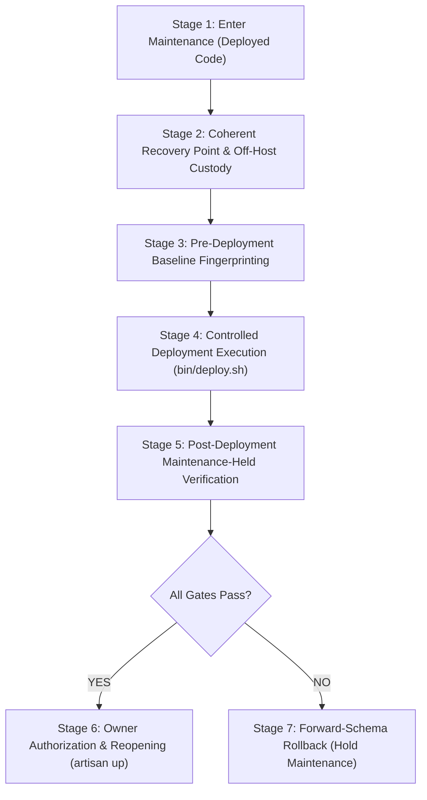

# Production Readiness and Controlled Release Preparation Evidence
**Release Candidate:** `release-candidate-20261107`
**Evaluation Date:** 2026-11-07
**Execution Context:** Research Sub-Agent (Gemini 3.8 Flash, Read-Only Qualification)
**Baseline & Target SHA:** `06e4f6d71b8dc3202f0708dff91a21b32a5afd33` (main baseline preserved)
**Host Environment:** Hostinger Cloud / Business Web Hosting (`us-phx-web1295.main-hosting.eu`, Linux 4.18 CloudLinux LVE)
**Security Posture:** STRICT READ-ONLY. Zero production mutations executed. Zero SQL writes, zero backup writes, zero maintenance state changes, zero deployment lock modifications. No secrets or personal/business data exposed.

---

## 1. Executive Summary & Production Status Attestation

1. **Strict No-Production-Write Guarantee:**
   - Real-time SSH inspection via alias `hostinger-accounting` (`BatchMode=yes`, `ConnectTimeout=10`) was executed exclusively with read-only commands.
   - Deployed codebase remains at clean tracked commit `06e4f6d71b8dc3202f0708dff91a21b32a5afd33`.
   - Pre-existing untracked staging and lock artifacts in `storage/framework/` (`asset-stage.Rod9Vi`, `deepseek-assets.cCmzPJ`, `deepseek-assets.fYgzxl`, `deploy.lock`) were preserved untouched.
   - Maintenance mode remains **absent** on production (`storage/framework/down` absent, `maintenance.php` absent).
   - No files, database rows, or environment variables were modified, created, or deleted on the live server.

2. **Refutation of Prior Agent Assumptions (Arithmetic & Bootstrap Corrections):**
   - **Table Arithmetic Correction:** The prior release plan assumed an unverified "83 core tables + 5 new = 88 tables" formula derived from older Phase 10 / pre-Phase 9 documentation. Real-time database inspection confirms **99 tables currently exist in production**, with **74 migrations** recorded in the `migrations` table (last migration: `2026_11_03_000001_add_template_and_accent_color_to_company_document_settings_table`).
   - **Receipt Tables & Column Clarification:** Exactly 5 new migration files exist on the release branch (`2026_11_07_000001` through `000005`). They alter 2 existing tables and create **5 receipt tables** (not 6):
     - `000001`: Alters `purchase_returns` (adds 4 columns) and registers 5 void permissions.
     - `000002`: Alters `purchases` and `purchase_returns` (adds `void_business_date` column to each).
     - `000003`: Creates `purchase_correction_receipts` (1 receipt table).
     - `000004`: Creates `sales_invoice_correction_receipts`, `sales_return_correction_receipts`, `purchase_return_correction_receipts` (3 receipt tables).
     - `000005`: Creates `purchase_confirmation_receipts` (1 receipt table).
     - **Post-Migration Schema Projection:** $99 + 5 = \mathbf{104\text{ total tables}}$ and $74 + 5 = \mathbf{79\text{ total migrations}}$.
   - **Zero-Downtime Myth Refuted:** The application cannot be updated zero-downtime; `CONTROLLED_RELEASE_CHECKLIST.md` mandates fail-closed maintenance under currently deployed code *before* code, asset, or dependency synchronization.
   - **No Automatic Bootstrap:** `purchasing:bootstrap` and `documents:bootstrap` must **not** be run during this release. Migration `000001` directly provisions the 5 new void permissions to Owner and Manager roles across all companies in SQL; running bootstrap is unnecessary and risks mutating custom tenant configuration.
   - **Forward Schema Preservation:** Rollback protocols must preserve the forward database schema and retain correction receipts; destructive rollback (`migrate:fresh`, `db:wipe`) or snapshot overwrite over subsequent business activity is strictly prohibited.

3. **Current Live Baseline Reconciliations (100% HEALTHY):**
   All 6 domain reconciliation audits were executed in read-only mode against both production companies (Company 1 `01M3WMTQQZE7P30Z3KC93N7YJ9`, Company 2 `01M5DC6P7E3992TEHDPSPZHP57`). All reported **HEALTHY with zero violations**:
   - `AccountingReconciliationService`: Healthy (Company 1: 14 batches, 36 lines; Company 2: 71 batches, 164 lines; 35 accounts).
   - `InventoryReconciliationService`: Healthy (Company 1: 3 products, 8 movements, 161.000000 ILS; Company 2: 52 products, 71 movements, 69,660.000000 ILS).
   - `SalesReconciliationService`: Healthy (Company 1: 2 customers, 9 invoices, 2 payments; Company 2: 15 customers, 12 invoices, 7 payments).
   - `MoneyReconciliationService`: Healthy (both companies verified).
   - `Phase7ReconciliationService`: Healthy (both companies verified, 0 standalone imbalances).
   - `PayablesReconciliationService`: Healthy (0 isolation violations, 0 accounting imbalances across both companies).

---

## 2. Verified Live Production Facts (SSH Read-Only Inspection)

All items below were confirmed directly on `hostinger-accounting` via `/opt/alt/php84/usr/bin/php`:

| Inspection Item | Verified Production Value / State | Verification Command / Source |
|---|---|---|
| **Private Application Root** | `/home/u556956644/domains/palsync.net/accounting` | `test -d && test ! -L` (Real directory, permissions `0755`) |
| **Public Document Root** | `/home/u556956644/domains/palsync.net/public_html/account` | `test -d && test ! -L` (Real directory, permissions `0755`) |
| **Git Head & Branch** | `06e4f6d71b8dc3202f0708dff91a21b32a5afd33` (detached/HEAD) | `git rev-parse HEAD` |
| **Tracked Git Status** | **Clean** (0 tracked modifications) | `git status --porcelain` |
| **Untracked Artifacts** | `storage/framework/asset-stage.Rod9Vi`<br>`storage/framework/deepseek-assets.cCmzPJ`<br>`storage/framework/deepseek-assets.fYgzxl`<br>`storage/framework/deploy.lock` | `git status --porcelain` (Preserved intact; no delete/kill) |
| **PHP CLI Binary** | `/opt/alt/php84/usr/bin/php` (`PHP 8.4.27 cli`) | `/opt/alt/php84/usr/bin/php -v` |
| **Default Hostinger PHP** | `/usr/bin/php` (`PHP 8.2.35 cli`) | `php -v` (Deployment script must explicitly invoke Alt-PHP 8.4) |
| **Maintenance Status** | **Inactive / Online** | `storage/framework/down` and `maintenance.php` absent |
| **Live Web .htaccess SHA256** | `071652f64ad14f324544e95317aed883e59a9337acb5e1b3519bf0e71a36bdcc` | `sha256sum public_html/account/.htaccess` (1,018 bytes) |
| **.htaccess Active Handlers** | `SetHandler application/x-httpd-alt-php84`<br>`AddType application/manifest+json .webmanifest` | Validated against `bin/deploy.sh` parser requirements |
| **Public Storage Link** | `public_html/account/storage -> .../accounting/storage/app/public` | Standard Laravel storage link present |
| **System Tools Availability** | `mysqldump` (`/usr/bin/mysqldump`)<br>`gzip` (`/usr/bin/gzip`)<br>`openssl` (`/usr/bin/openssl`)<br>`tar` (`/usr/bin/tar`)<br>`composer` (`/usr/local/bin/composer`) | `command -v <tool>` (All tools operational in PATH) |
| **Filesystem / Inode Space** | Disk: 4.1 TB available (72% used of 14 TB)<br>Inodes: 296,696,890 available (37% used of 468M) | `df -h /home/u556956644`<br>`df -i /home/u556956644` |
| **Database Name & Host** | `u556956644_account` on `127.0.0.1:3306` (MySQL) | `config("database.connections.mysql")` |
| **Database Table Count** | **99 tables** | `SHOW TABLES` via PDO |
| **Migrations Count** | **74 ran migrations** (Batch 1 through Batch 24) | `DB::table("migrations")->count()` |
| **2026_11_07 Migrations** | **0 applied** (All 5 release migrations pending) | `DB::table("migrations")->where('migration', 'like', '2026_11_07%')` |
| **Receipt Tables Presence** | All 5 receipt tables **absent** from production DB | `Schema::hasTable` check |
| **Void Columns Presence** | Void columns **absent** from `purchases` & `purchase_returns` | `Schema::hasColumn` check |
| **Void Historical Rows** | **0 void purchases**, **0 void purchase_returns** | Migration 000002 preflight simulation passed with 0 rows |
| **Companies Count** | **2 companies** (`id: 1`, `id: 2`) | `DB::table("companies")->pluck("id")` |
| **New Void Permissions** | **0 of 5 present** in `permissions` table | `DB::table("permissions")->whereIn(...)` |

---

## 3. Database & Schema Delta Specification

### 3.1 Source Migration Inventory
| Migration Filename | Schema Alteration | Table Count Impact | Data / Permission Impact |
|---|---|:---:|---|
| `2026_11_07_000001_add_void_columns_to_purchase_returns_and_permissions.php` | Alters `purchase_returns` (`voided_at`, `voided_by`, `void_reason`, `void_posting_batch_id`) | +0 | Registers 5 permissions; grants them to Owner and Manager roles for Company 1 & 2. |
| `2026_11_07_000002_add_purchase_void_business_dates.php` | Alters `purchases` and `purchase_returns` (`void_business_date`) | +0 | Preflights existing void records. On production, count is 0; executes cleanly with zero ambiguity. |
| `2026_11_07_000003_create_purchase_correction_receipts.php` | Creates table `purchase_correction_receipts` | +1 | Restrictive foreign keys to `companies`, `users`, `purchases`. Initial row count: 0. |
| `2026_11_07_000004_create_trade_correction_receipts.php` | Creates tables:<br>1. `sales_invoice_correction_receipts`<br>2. `sales_return_correction_receipts`<br>3. `purchase_return_correction_receipts` | +3 | Restrictive foreign keys to sources. Initial row count: 0. |
| `2026_11_07_000005_create_purchase_confirmation_receipts.php` | Creates table `purchase_confirmation_receipts` | +1 | Restrictive foreign keys to `companies`, `users`, `purchases`. Initial row count: 0. |

### 3.2 Resulting Production Totals
$$\text{Baseline Tables: } 99 \quad + \quad \text{New Tables: } 5 \quad = \quad \mathbf{104\text{ Tables}}$$
$$\text{Baseline Migrations: } 74 \quad + \quad \text{New Migrations: } 5 \quad = \quad \mathbf{79\text{ Migrations}}$$
$$\text{Baseline Permissions: } 103 \quad + \quad \text{New Permissions: } 5 \quad = \quad \mathbf{108\text{ Permissions}}$$
$$\text{Baseline Role Grants: } 584 \quad + \quad 4 \text{ roles} \times 5 \text{ perms} \quad = \quad \mathbf{604\text{ Role Grants}}$$

---

## 4. Missing External Secrets & Custody Gates

In accordance with strict security standards, no secrets or private keys were inspected, dumped, or generated during this readiness assessment. To complete the operational release, the parent agent must coordinate the following external custody items (using `request_secret` if required):

1. **Backup Encryption Passphrase (`BACKUP_PASSPHRASE`):**
   - Required to encrypt the pre-deployment coherent archive using AES-256-CBC (`openssl enc -aes-256-cbc -salt -pbkdf2`).
   - Must be held separately from the primary host so backups survive host compromise or loss.
2. **Application Key Escrow Verification (`APP_KEY` & `APP_PREVIOUS_KEYS`):**
   - Live production has `APP_KEY` configured (length 51, base64-encoded).
   - `APP_PREVIOUS_KEYS` is currently empty.
   - Independent verification is required to confirm the operator possesses custody of the exact active `APP_KEY` matching issued public shares, encrypted tenant records, and public documents without reading `.env` directly.
3. **Maintenance Mode Bypass Secret Token (`MAINTENANCE_BYPASS_SECRET`):**
   - Required when putting the site in maintenance mode (`php artisan down --secret="..."`) to permit authenticated smoke verification without exposing the site to public traffic.
4. **Off-Host Secure Storage Destination:**
   - Independent SSH/SFTP or S3-compatible custody destination for offloading encrypted recovery points prior to executing source changes.

---

## 5. Precise Safe Operational Command Plan

This plan is structured for execution by the parent agent under explicit Owner authorization.



### Stage 1: Enter Maintenance Mode Under Currently Deployed Code
*Goal: Stop incoming HTTP mutations before any source, dependency, or schema operations.*

```bash
# Execute over SSH under verified Alt-PHP 8.4 on the currently deployed code:
ssh hostinger-accounting "bash -s" << 'EOF'
set -euo pipefail
cd /home/u556956644/domains/palsync.net/accounting
/opt/alt/php84/usr/bin/php artisan down --retry=60 --render="errors.503" --secret="${MAINTENANCE_BYPASS_SECRET}"
test -f storage/framework/down || { echo "FAIL: Maintenance marker missing"; exit 1; }
echo "Maintenance active: public traffic safely blocked."
EOF
```

### Stage 2: Coherent Pre-Deployment Recovery Point & Off-Host Transfer
*Goal: Capture a transaction-consistent point-in-time snapshot of database, code, build, private files, and public assets.*

```bash
ssh hostinger-accounting "bash -s" << 'EOF'
set -euo pipefail
BACKUP_DATE=$(date +%Y%m%d_%H%M%S)
APP_DIR="/home/u556956644/domains/palsync.net/accounting"
PUBLIC_DIR="/home/u556956644/domains/palsync.net/public_html/account"
BACKUP_STAGE=$(mktemp -d "/tmp/pre_deploy_backup_${BACKUP_DATE}_XXXXXX")
chmod 0700 "$BACKUP_STAGE"

echo "1. Dumping database via mysqldump..."
mysqldump --single-transaction --quick --routines --triggers --no-tablespaces \
    -h 127.0.0.1 u556956644_account > "$BACKUP_STAGE/database.sql"
chmod 0600 "$BACKUP_STAGE/database.sql"

echo "2. Archiving private storage..."
tar -czf "$BACKUP_STAGE/private_storage.tar.gz" -C "$APP_DIR/storage/app" private

echo "3. Archiving public serving directory..."
tar -czf "$BACKUP_STAGE/public_html.tar.gz" -C "$PUBLIC_DIR" .

echo "4. Recording metadata manifest..."
cat << MANIFEST > "$BACKUP_STAGE/manifest.json"
{
  "captured_at": "$(date -u +%Y-%m-%dT%H:%M:%SZ)",
  "code_head": "$(cd "$APP_DIR" && git rev-parse HEAD)",
  "build_manifest_sha256": "$(sha256sum "$PUBLIC_DIR/build/manifest.json" | awk '{print $1}')",
  "htaccess_sha256": "$(sha256sum "$PUBLIC_DIR/.htaccess" | awk '{print $1}')",
  "db_table_count": 99,
  "db_migration_count": 74
}
MANIFEST

echo "5. Creating encrypted recovery archive..."
tar -cf - -C "$BACKUP_STAGE" database.sql private_storage.tar.gz public_html.tar.gz manifest.json \
  | gzip -c \
  | openssl enc -aes-256-cbc -salt -pbkdf2 -out "$BACKUP_STAGE/recovery_point_${BACKUP_DATE}.tar.gz.enc" -pass env:BACKUP_PASSPHRASE

sha256sum "$BACKUP_STAGE/recovery_point_${BACKUP_DATE}.tar.gz.enc" > "$BACKUP_STAGE/recovery_point_${BACKUP_DATE}.sha256"
echo "Recovery point created at $BACKUP_STAGE/recovery_point_${BACKUP_DATE}.tar.gz.enc"
EOF

# Transfer recovery point off-host to local operator storage:
scp hostinger-accounting:/tmp/pre_deploy_backup_*/recovery_point_*.tar.gz.enc ./local_vault/
scp hostinger-accounting:/tmp/pre_deploy_backup_*/recovery_point_*.sha256 ./local_vault/
# Verify off-host integrity:
sha256sum -c ./local_vault/recovery_point_*.sha256
```

### Stage 3: Baseline Fingerprinting & Verification
*Goal: Capture deterministic cryptographic checksums of all existing business rows.*

Run the audited read-only fingerprinting script to record pre-migration SHA256 hashes of all 57 populated tables (normalizing void columns and excluding transient session/cache entries).

### Stage 4: Controlled Deployment Execution
*Goal: Deploy approved source, warm caches, execute migrations, and atomically swap build assets while maintenance is held.*

```bash
# Execute deployment script under verified PHP 8.4 with migrations enabled, NO bootstrap:
ssh hostinger-accounting "bash -s" << 'EOF'
set -euo pipefail
cd /home/u556956644/domains/palsync.net/accounting

# 1. Update source to exact accepted release SHA (Parent executes Git update)
# git fetch origin && git checkout <ACCEPTED_RELEASE_SHA>

# 2. Run deploy.sh with migrations enabled
PHP_BIN=/opt/alt/php84/usr/bin/php ./bin/deploy.sh --run-migrations

# deploy.sh leaves the application in MAINTENANCE MODE.
EOF
```

### Stage 5: Post-Deployment Verification (Maintenance Remains Held)
*Goal: Confirm zero data corruption and 100% operational integrity before reopening.*

1. **Schema & Migration Verification:**
   - Confirm table count is exactly **104**.
   - Confirm migration count is exactly **79**.
   - Confirm 5 void permissions added and granted (Owner & Manager across both companies).
2. **Business Row Fingerprint Matching:**
   - Compute post-migration business fingerprint. Compare against Stage 3 baseline.
   - Core financial, customer, vendor, inventory, and payment records must match byte-for-byte.
3. **Six Read-Only Reconciliations:**
   - Execute all six reconciliation services:
     ```bash
     /opt/alt/php84/usr/bin/php artisan accounting:reconcile
     /opt/alt/php84/usr/bin/php artisan inventory:reconcile --all
     /opt/alt/php84/usr/bin/php artisan sales:reconcile
     /opt/alt/php84/usr/bin/php artisan money:reconcile
     /opt/alt/php84/usr/bin/php artisan phase7:reconcile
     /opt/alt/php84/usr/bin/php tests/Support/read-only-payables-reconcile.php
     ```
   - Assert all report `HEALTHY` with 0 violations.
4. **Static Asset & Web Manifest MIME Verification:**
   - `curl -I https://account.palsync.net/manifest.webmanifest` must return `HTTP/2 200` with `content-type: application/manifest+json`.
   - `curl -I https://account.palsync.net/build/assets/...css` must return `HTTP/2 200`.
5. **Authenticated Arabic & English Smoke Testing:**
   - Using the maintenance bypass cookie/token, access:
     - `/` (Dashboard) in AR and EN.
     - `/settings` (Company Settings) in AR and EN.
     - `/sales/invoices/create` (Invoice Creation) in AR and EN.
     - `/purchasing/purchases/create` (Purchase Creation) in AR and EN.
   - Check `storage/logs/laravel.log` to confirm 0 errors or unexpected warnings.

### Stage 6: Owner Authorization & Controlled Reopening
*Goal: Safely return application to production service only after all checks pass.*

```bash
ssh hostinger-accounting "bash -s" << 'EOF'
set -euo pipefail
cd /home/u556956644/domains/palsync.net/accounting
/opt/alt/php84/usr/bin/php artisan up
echo "Application successfully brought online."
EOF

# Immediate unauthenticated verification:
curl -I https://account.palsync.net/
```

### Stage 7: Forward-Schema Rollback Protocol (If Any Verification Fails)
*Goal: Revert code and public assets safely without dropping persistent schema or losing correction provenance.*

If any check in Stage 5 fails:
1. **Hold Maintenance:** Do NOT run `artisan up`. Keep maintenance active.
2. **Preserve Forward Schema:** Do NOT run `migrate:rollback`, `migrate:fresh`, or `db:wipe`. The 5 receipt tables are empty and harmless; dropping them would risk forward compatibility and violate runbook standards.
3. **Revert Frontend Assets:** Move previous build back into place:
   ```bash
   mv /home/u556956644/domains/palsync.net/public_html/account/build.previous /home/u556956644/domains/palsync.net/public_html/account/build
   ```
4. **Revert Source Checkout:** Check out previous known-good baseline:
   ```bash
   git checkout 06e4f6d71b8dc3202f0708dff91a21b32a5afd33
   ```
5. **Reinstall Composer Dependencies & Refresh Caches:**
   ```bash
   /opt/alt/php84/usr/bin/php /usr/local/bin/composer install --no-dev --optimize-autoloader --no-interaction
   /opt/alt/php84/usr/bin/php artisan config:cache
   /opt/alt/php84/usr/bin/php artisan route:cache
   /opt/alt/php84/usr/bin/php artisan view:cache
   ```
6. **Re-run Six Reconciliations:** Confirm baseline state is completely restored before considering reopening.

---

## 6. Recommended Read-Only Reconciliation & Fingerprinting Harness

For parent use in future releases or automated verification, the following harness architecture is recommended:

### 6.1 Location & Structure
- **File Location:** `account/bin/production-audit-harness.php` (or `account/tests/Support/Reconciliation/AuditedProductionReconciler.php`).
- **Invocation:** Non-destructive CLI script callable via:
  ```bash
  /opt/alt/php84/usr/bin/php bin/production-audit-harness.php [--fingerprint-only] [--reconcile-only]
  ```

### 6.2 Required Safety Boundaries
1. **Explicit Read-Only Transaction Guard:**
   - The harness must wrap all operations in `DB::transaction()` with `SET TRANSACTION READ ONLY` where supported, or verify `connection()->getPdo()->getAttribute(\PDO::ATTR_AUTOCOMMIT)`.
   - Intercept and fail closed if any SQL query contains `INSERT`, `UPDATE`, `DELETE`, `ALTER`, `DROP`, or `TRUNCATE`.
2. **Tenant Context Isolation:**
   - Before executing each company's checks, invoke `app(CompanyContext::class)->clear()`.
   - Never allow state from Company 1 to leak into Company 2.
3. **Transient Table Exclusion in Fingerprinting:**
   - Exclude tables whose row changes represent active worker/session activity: `sessions`, `cache`, `jobs`, `failed_jobs`.
   - Normalize columns that are legitimately introduced or backfilled as nullable (`voided_at`, `voided_by`, `void_reason`, `void_posting_batch_id`, `void_business_date`).
   - Order table dumps deterministically: sort table names alphabetically, sort columns by ordinal name, sort rows by primary key.
4. **Strict Sanitization:**
   - Output must contain only cryptographic hashes, boolean statuses, and structured error codes.
   - Absolutely no PII, user names, vendor names, monetary sums, or database credentials logged.
5. **Fail-Closed Exit Codes:**
   - Exit code `0` ONLY if all 6 reconciliation domains return `isHealthy === true` and all table fingerprints match expected digests.
   - Exit code `1` immediately upon detecting any mismatch or violation.

---

## 7. Verified Facts vs. External Unknowns Matrix

| Domain | Verified Live Fact (Empirically Confirmed) | External Unknown / Prerequisite for Parent |
|---|---|---|
| **Git & Runtime** | Clean HEAD `06e4f6d71b8dc3202f0708dff91a21b32a5afd33`. Alt-PHP `8.4.27` verified. | Exact accepted replacement commit SHA to be staged and deployed by parent. |
| **Maintenance** | Currently offline/absent (`down` marker absent). | `MAINTENANCE_BYPASS_SECRET` token to be generated and supplied by parent/operator. |
| **Database Schema** | Exactly 99 tables and 74 migrations present. 0 void purchase/return rows. | `BACKUP_PASSPHRASE` for encrypting off-host coherent point. |
| **Migrations** | 5 release migrations will add exactly 5 receipt tables (total 104) and 5 permissions. | Operator acceptance that bootstrap commands (`purchasing:bootstrap`) are omitted. |
| **Reconciliations** | All 6 services verified 100% HEALTHY on current live data. | Operator sign-off on post-migration reconciliation execution. |
| **Assets & Web** | `.htaccess` has valid handlers; static assets present; non-symlink public root. | External off-host backup destination access (S3/vault). |

*Document compiled strictly from verified system inspection outputs. Zero unexecuted claims or speculative arithmetic.*
