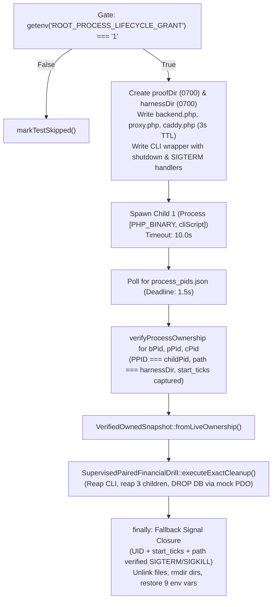

# Mobile V2 Advanced Next-Stage Packet & Source Audit

**Date:** 2026-11-16  
**Commit Head:** `f696d905e72a94e93aa934877bcbd14e4d7a081f`  
**Branch:** `t3/recover-cash-writer`  
**Pull Request:** [#102](https://github.com/Bassamalsaqqa/account/pull/102)  
**Execution Authority:** **SOURCE-ONLY AUDIT & PREPARATION ONLY** (No financial execution, no Android runtime, no DB/network)

---

## 1. Executive Summary & Qualification Provenance

Following the resolution of the probe report builder reconciliation SHA contract and typed reconciliations dictionary defects, Root independently qualified commit `f696d905e72a94e93aa934877bcbd14e4d7a081f` **OFFLINE ONLY** across two distinct, bounded test filters:

### 1.1 Root Independent Qualification Runs (Commit `f696d905e72a94e93aa934877bcbd14e4d7a081f`)
1. **Filter 1 (Pure Advanced Contract - 12 Methods):**
   - **Evidence Path:** `/home/t3dev/.t3/userdata/attachments/root-advanced-contract-pure-30wa84br` (mode `0700/0600`)
   - **Result:** `12 tests, 63 assertions, PASS, exit 0`
   - **Coverage:** Verified genuine producer-to-supervisor-to-trusted-compose-to-advanced-validator flow, report verification, manifest validation, ACP containment, path traversal refusal, semantic failure refusal, wrong event reports, primary event ID collisions, and sentinel out-of-root containment.
2. **Filter 2 (Bounded Child CLI Basic - 2 Methods):**
   - **Evidence Path:** `/home/t3dev/.t3/userdata/attachments/root-advanced-cli-basic-pure-2mcp_ubj` (mode `0700/0600`)
   - **Result:** `2 tests, 11 assertions, PASS, exit 0`
   - **Coverage:** Verified bounded child CLI default-deny validations and supervisor CLI flag wiring under poisoned execution ports (`port=1`), `ALLOW=0`, `HARNESS=0`, `ROOT_PROCESS_LIFECYCLE_GRANT=0`, with strictly zero DB or network access.

### 1.2 Historical Failure Records Preserved
All historical offline qualification artifacts remain preserved in the environment for complete auditability:
- `/home/t3dev/.t3/userdata/attachments/root-advanced-contract-pure-k06oqtaw`: 1 test, 0 assertions, 1 ERROR, exit 2 (Missing class import `DisposableFinancialPostRunInspector`).
- `/home/t3dev/.t3/userdata/attachments/root-advanced-contract-pure-2iq4l9is`: 1 test, 0 assertions, 1 ERROR, exit 2 (Stale database baseline snapshot fields vs strict 9-table scanner contract).
- `/home/t3dev/.t3/userdata/attachments/root-advanced-contract-pure-wz22k4sl`: 9 tests, 53 assertions, 8 PASS, 1 FAIL, exit 1 (`test_advanced_scope_requires_mandatory_acp_in_compose_and_validation` basename mismatch).
- `/home/t3dev/.t3/userdata/attachments/root-advanced-contract-pure-3jjt47ic`: 9 tests, 45 assertions, 8 PASS, 1 ERROR, exit 2 (`buildProbeReportPayload` missing mandatory `reconciliation_artifact_sha256` in fixture helper).

### 1.3 Qualification Boundary & Limitations
- **Offline Qualification Only:** The passing runs validate offline unit/pure-contract behavior and default-deny CLI subprocess containment.
- **Not 14 Advanced Financial Proof:** These two successful filters represent separate bounded unit checks at the same source tree; they do not constitute full end-to-end advanced financial acceptance proofs across live network boundaries.
- **Physical Invariance:** Tracked backend bytehash, git HEAD (`f696d905e72a94e93aa934877bcbd14e4d7a081f`), and git status are identical pre- and post-qualification.
- **Zero Heavy Jobs:** No Android emulator, Gradle compilation, MySQL daemons, or OS child processes were spawned by Root or writer.

---

## 2. Authoritative Source Pins & Artifact SHA Index

All source code components, command scripts, and schema manifests are pinned and tracked under [mobile-v2-integration-manifest.json](file:///home/t3dev/.t3/worktrees/account/integration-mobile-backend-supervision/docs/integration/mobile-v2-integration-manifest.json):

| Component / Artifact | Path / Class | Canonical SHA-256 Digest |
| :--- | :--- | :--- |
| **Commit Head** | `t3/recover-cash-writer` | `f696d905e72a94e93aa934877bcbd14e4d7a081f` |
| **Source Fixture** | [`Tests\Support\Harness\DisposableMobileV2BackendHarness`](file:///home/t3dev/.t3/worktrees/account/integration-mobile-backend-supervision/tests/Support/Harness/DisposableMobileV2BackendHarness.php) | `d5a113cebe6e3222196fb5e7060a3f7a89e3fa48f5204c7da25956b78ce2bda8` |
| **Guard Test** | [`Tests\Unit\Mobile\Harness\DisposableMobileV2BackendHarnessGuardTest`](file:///home/t3dev/.t3/worktrees/account/integration-mobile-backend-supervision/tests/Unit/Mobile/Harness/DisposableMobileV2BackendHarnessGuardTest.php) | `e5b06e095a2057a2b63343cd6ca3a0af6e85983e21d6a80b87845d39ffef0788` |
| **CLI Command Class** | [`Tests\Support\Harness\MobileV2HarnessCommand`](file:///home/t3dev/.t3/worktrees/account/integration-mobile-backend-supervision/tests/Support/Harness/MobileV2HarnessCommand.php) | `0bda2eff08fc674b5493dffe58b229541be8ff468a045cc2e3cca55ff6dc4cc6` |
| **CLI Runner Script** | [`tests/Support/Harness/mobile-v2-harness-cli.php`](file:///home/t3dev/.t3/worktrees/account/integration-mobile-backend-supervision/tests/Support/Harness/mobile-v2-harness-cli.php) | `13a9d9b630e63213e91537a14c43a964c4bc209743604c90527685b452dfe372` |
| **Sale Commit Schema** | `sale-commit-response.json` | `401dbb3c2528a30edfb6beaa5065e89bf225c348a4d88eba9d47d7f93cff543a` |
| **Sale Status Schema** | `sale-event-status-response.json` | `25e6c6173d646ee4b1dc8dbb0d26d20f0311535863e3d73836af7474c6714591` |
| **Intake Request Schema** | `offline-sale-intake-request.json` | `0af62ee5058b0dc9da0c8a52c905112de1ff37a9bc040b3740543264c9a2c142` |
| **Client Handoff Schema** | `client-handoff-schema.json` | `edaef0309765e10d6462b36b5c660eb02f65c057c810ab72f756f7664e3ca275` |
| **Intent Profile Digest** | Revision 3 Canonical JCS Digest | `sha256:0847e10d89777e103252ebfa2d27f89a95832a5d70e01af57afe6423f703c630` |

---

## 3. Inventory of Remaining Executable Dependencies

Executing live advanced qualifications requires lifting specific environmental and structural gates. The complete inventory of remaining executable prerequisites comprises:

### 3.1 Advanced Proxy Lifecycle & 3-Child Lineage
- **Root Process Lifecycle Grant:** Requires `ROOT_PROCESS_LIFECYCLE_GRANT=1` (currently enforced to `0` under source-only constraints).
- **Process Supervisor Facilities:** Requires OS-level `proc_open`, `pcntl_signal`, `posix_kill`, and accurate `/proc/<pid>/stat` clock ticks inspection for non-recycled PID tracking.
- **Process Lineage Tree:** Child 1 (CLI harness) must spawn and actively supervise three dedicated child processes:
  1. Backend API service (`backend.php`)
  2. TCP fault proxy (`proxy.php`)
  3. Reverse proxy / TLS termination (`caddy.php`)
- **Process PIDs Interlock:** `process_pids.json` (mode `0600`) written by CLI, validated by [`SupervisedPairedFinancialDrill::verifyProcessOwnership`](file:///home/t3dev/.t3/worktrees/account/integration-mobile-backend-supervision/tests/Support/Harness/SupervisedPairedFinancialDrill.php).

### 3.2 Network Framing & Transport Witness
- **Active Fault Proxy Boundary:** Requires live socket proxy implementing `TEST_TRANSPORT_BOUNDARY_SINGLE_RESPONSE_DROP` mode.
- **Transport Drop Witness File:** Generation of `lost_ack_witness_v1` JSON structure in private directory (mode `0700` parent dir, mode `0600` file, current UID ownership).
- **Mandatory Witness Assertions:**
  - `db_commit_verified === true`
  - `proxy_socket_closed_without_response === true`
  - `bytes_forwarded === 0`
  - Non-null 64-hex `target_nonce_hash`
  - Positive integers for `sales_invoice_id` and `customer_payment_id`
  - Pre-suppression status `201`
- **Client Recovery Verification:** Retained event recovery verification hitting `/status` endpoint, obtaining HTTP `200` with `receipt_status === 'posted'` matching authoritative payload digest.

### 3.3 Rollback Observer & 9-Table Zero Delta Verification
- **Disposable Database Instance:** Requires active MySQL database on disposable port (not poisoned `port=1`), governed by:
  - `PHASE8_ALLOW_DISPOSABLE_DB=1`
  - `PHASE8_TEST_DB_HOST`, `PHASE8_TEST_DB_PORT`, `PHASE8_TEST_DB_USERNAME`, `PHASE8_TEST_DB_PASSWORD`
  - `PHASE8_DISPOSABLE_DB_PROOF` (mode `0600` JSON proof file)
  - `PHASE8_DISPOSABLE_DB_NONCE` (matching 32-character hex nonce)
- **Authoritative Scanner Metrics:** Strict capture of pre- and post-probe database state via [`DisposableFinancialPostRunInspector::captureRollbackProbeSnapshot`](file:///home/t3dev/.t3/worktrees/account/integration-mobile-backend-supervision/tests/Support/Harness/DisposableFinancialPostRunInspector.php):
  - 9 exact financial table counts: `sales_invoices`, `sales_invoice_lines`, `sales_invoice_lot_allocations`, `customer_payments`, `customer_payment_allocations`, `mobile_event_receipts`, `stock_movements`, `posting_batches`, `posting_lines`.
  - Document sequence values map.
  - 9 individual table 64-hex SHA-256 fingerprint strings.
  - Decimal strings for `stock_movements_qty_delta_base` and `lot_allocations_qty_allocated_base`.
  - Authoritative composite `row_fingerprint_sha256`.
- **Zero Delta Proof:** Strict `assertRollbackZeroDelta` equality asserting zero net database delta across all rollback probes.
- **Reconciliation Health Verification:** Independent execution of all 6 core financial reconcilers (`Accounting`, `Inventory`, `Sales`, `Payables`, `Money`, `Phase7`), requiring `healthy === true` and `issue_count === 0`.

### 3.4 Private Advanced Control Packet (ACP)
- **Containment & File Security:** Target file must be named `advanced_control_packet.json`, stored in mode `0700` parent directory, mode `0600` file permissions, owned by current UID, strictly refusing symlinks.
- **UUID Uniqueness & Partitioning:** Maps three distinct probe event UUIDs that **must not collide** with the primary transaction client event ID:
  - `permission_denial` -> Expected HTTP `403`
  - `insufficient_stock` -> Expected HTTP `422`
  - `controlled_fault_after_posting` -> Expected HTTP `500`

### 3.5 Schema Proof & Live Approval Call Graph
- **Schema Presence:** Verified via PDO `INFORMATION_SCHEMA.SCHEMATA` query before execution and post-cleanup DROP validation.
- **Live Approval File:** Creation of Root live approval witness file following candidate handoff inspection.

---

## 4. Missing Android Advanced Producer & QA Prerequisites

The Android candidate evaluated in prior basic runs (`f697451719d2940bde89a8aab5b6770d93c7b823` / PR base `0ccce244`) was scoped strictly to basic single-shot online sale intake under `ZERO_NEW_QA_ACCEPTANCE_UNDER_REVIEW`. It does **not** provide the advanced probe execution lineage.

### 4.1 Missing Android Advanced Producer Capabilities
1. **7-Scenario Orchestration Lineage:** The client runner currently lacks multi-scenario sequencing required by `v2_advanced_probe_evidence_v1`:
   - `readiness_probe` (HTTP 200)
   - `transport_lost_ack_retained_status_recovery` (HTTP 200 via `/status`)
   - `idempotent_replay_integrity` (HTTP 200 replay)
   - `tamper_rejection_integrity` (HTTP 409 conflict)
   - `rollback_permission_denial` (HTTP 403)
   - `rollback_insufficient_stock` (HTTP 422)
   - `rollback_controlled_after_posting` (HTTP 500)
2. **ACP Ingestion & Probe UUID Binding:** Inability to ingest `advanced_control_packet.json` to dynamically bind distinct client event IDs per probe rather than hardcoded static UUIDs.
3. **Transport Drop Handling:** Missing Android client network boundary retry logic that captures and validates TCP drops without emitting duplicate requests on non-idempotent endpoints.
4. **Evidence Packaging:** Inability to assemble and serialize `v2_advanced_probe_evidence_v1` with embedded scenario records, lost ACK evidence, and rollback probe receipts.

### 4.2 New Source QA & Binding Prerequisites
- **Peer Android Binding Record:** Requires Root-attested `binding.json` linking approved publication HEAD to executable HEAD.
- **Executable Source Parity Enforcement:** Must verify that `git diff pub_head exe_head` contains **strictly** documentation files (`docs/`, `README.md`, `CHANGELOG.md`) under `APPROVED_DOCS_DELTA_PREFIXES`. Any modification to `.kt`, `.java`, or Gradle scripts must fail closed.
- **Decoupled Operator Configuration:** Android execution must be orchestrated through [`supervised-paired-drill-operator.py`](file:///home/t3dev/.t3/worktrees/account/integration-mobile-backend-supervision/tests/Support/Harness/supervised-paired-drill-operator.py) using external Root manifests, prestart approvals, and fresh output directories.

---

## 5. Source Audit: `test_bounded_throwaway_advanced_three_child_lineage_and_lifecycle`

**Location:** [`tests/Unit/Mobile/Harness/DisposableMobileV2BackendHarnessGuardTest.php`](file:///home/t3dev/.t3/worktrees/account/integration-mobile-backend-supervision/tests/Unit/Mobile/Harness/DisposableMobileV2BackendHarnessGuardTest.php#L6935-L7253)  
**State:** Authored, complete, strictly **UNRUN** (`ROOT_PROCESS_LIFECYCLE_GRANT !== '1'`).



### 5.1 Lineage & Process Hierarchy
- **Child 1 (CLI Process):** Spawned via Symfony `Process` executing `mobile-v2-harness-cli.php`.
- **Children 2, 3, 4 (Backend, Proxy, Caddy):** Spawned by Child 1 via `proc_open` with individual pipe arrays.
- **Process PIDs Communication:** Child 1 records `backend_pid`, `proxy_pid`, and `caddy_pid` in `process_pids.json` (mode `0600`).
- **Child 1 Self-Reaping:**
  - `register_shutdown_function` reaps children with `proc_terminate($p, 15)`.
  - `pcntl_signal(SIGTERM)` dispatches child termination and exits `0`.

### 5.2 Exact Timeouts, TTLs, and Deadlines
- **Child Script Sleep TTL:** `usleep(3000000)` (3.0 seconds) in `backend.php`, `proxy.php`, `caddy.php`.
- **CLI Wait Loop:** Monotonic wait using `hrtime(true) / 1e9` for 3.0 seconds, dispatching signals every 50ms.
- **PIDs JSON Poll Deadline:** 1.5 seconds (`((hrtime(true) / 1e9) - $wStart) < 1.5`, 25ms sleep).
- **Process Wrapper Timeout:** `10.0` seconds (`$process->setTimeout(10.0)`).
- **Process Stop Grace Period:** `1.0` second (`$process->stop(1.0)`).

### 5.3 Temporary Directory & File Lifecycle
| Artifact | Creation Path | Mode | Cleanup Responsible |
| :--- | :--- | :--- | :--- |
| **Proof Directory** | `sys_get_temp_dir() . '/p8_proof_' . bin2hex(...)` | `0700` | Primary cleanup + `finally` fallback |
| **Proof File** | `$proofDir . '/proof.json'` | `0600` | Primary cleanup + `finally` fallback |
| **Harness Directory** | `sys_get_temp_dir() . '/v2_harness_' . bin2hex(...)` | `0700` | Primary cleanup + `finally` fallback |
| **PIDs JSON** | `$harnessDir . '/process_pids.json'` | `0600` | Primary cleanup + `finally` fallback |
| **Backend Script** | `$harnessDir . '/backend.php'` | `0700` | Primary cleanup + `finally` fallback |
| **Proxy Script** | `$harnessDir . '/proxy.php'` | `0700` | Primary cleanup + `finally` fallback |
| **Caddy Script** | `$harnessDir . '/caddy.php'` | `0700` | Primary cleanup + `finally` fallback |
| **CLI Script** | `$harnessDir . '/mobile-v2-harness-cli.php'` | `0700` | Primary cleanup + `finally` fallback |

### 5.4 Process Cleanup Exception Paths & Hardening
1. **Primary Cleanup Path:** [`SupervisedPairedFinancialDrill::executeExactCleanup`](file:///home/t3dev/.t3/worktrees/account/integration-mobile-backend-supervision/tests/Support/Harness/SupervisedPairedFinancialDrill.php):
   - Reaps Child 1 (`$childProcess->stop()`).
   - Verifies process ownership for each child PID before terminating.
   - Terminates `bPid`, `pPid`, `cPid` via verified signals.
   - Asserts non-liveness (`!isProcessAlive($pid)`).
   - Executes mock PDO `DROP DATABASE IF EXISTS`.
   - Removes `$harnessDir` and `$proofDir`.
2. **Finally Block Exception Fallback:**
   - Unconditionally stops `$process` if running (`$process->stop(1.0)`).
   - **Safe Verified Fallback Signal Closure (`$safeVerifiedFallbackSignal`):**
     - Checks `pid !== null`, `pid > 0`, and `isProcessAlive($pid)`.
     - Calls `SupervisedPairedFinancialDrill::verifyProcessOwnership` validating:
       - Process exists and matches current UID
       - PPID matches `expectedPpid` (or init/systemd adoption)
       - Process start ticks (`/proc/<pid>/stat`) exactly match `start_ticks` captured at birth
       - Command line contains `expectedPathSubstring` (`$harnessDir`)
     - Issues `SIGTERM`, waits 50ms, re-checks ownership, and escalates to `SIGKILL` only if still verified alive.
     - **Safety Guarantee:** Under no circumstance can signals be dispatched to arbitrary or recycled PIDs.
   - Unconditionally unlinks all 5 script and data files.
   - Unconditionally removes directories with `@rmdir`.
   - Unconditionally restores all 9 environment variables (`$savedEnv`).

### 5.5 Exact Invocation Specification for Root Review
To execute this test under controlled Root review, the exact execution vector is:

```bash
# 1. Environment configuration
export ROOT_PROCESS_LIFECYCLE_GRANT=1
export APP_ENV=testing
export PHASE8_ALLOW_DISPOSABLE_DB=1
export PHASE8_TEST_DB_HOST=127.0.0.1
export PHASE8_TEST_DB_PORT=3342
export PHASE8_TEST_DB_USERNAME=root
export PHASE8_TEST_DB_PASSWORD=""
export PHASE8_TEST_DB_EMPTY_PASSWORD=1
export PHASE8_DISPOSABLE_DB_PROOF="/tmp/p8_proof_<hex>/proof.json"
export PHASE8_DISPOSABLE_DB_NONCE="<32_char_hex_nonce>"

# 2. Command vector
php vendor/bin/phpunit --filter test_bounded_throwaway_advanced_three_child_lineage_and_lifecycle tests/Unit/Mobile/Harness/DisposableMobileV2BackendHarnessGuardTest.php
```

---

## 6. Preservation of Baseline Contracts & Isolation

- **Basic Wire Golden Invariance:** The canonical Revision 3 payload and Case 7 synthetic wire records remain physically unchanged.
- **Basic Scope Key Invariance:** `composeTrustedDbReport` preserves its canonical basic keys (`schema_name`, `company_id`, `source_head`, `handoff_digest`, `baseline_hash`, `report_digest`) without polluting the basic report structure with advanced aliases.
- **Worktree Isolation:** This audit was prepared strictly within worktree `/home/t3dev/.t3/worktrees/account/integration-mobile-backend-supervision`. No peer worktrees (including web selector audit or Android read-only worktree) were inspected or modified.
- **Source-Only Integrity:** No tests, databases, background daemons, or child processes were executed during this turn.

---
