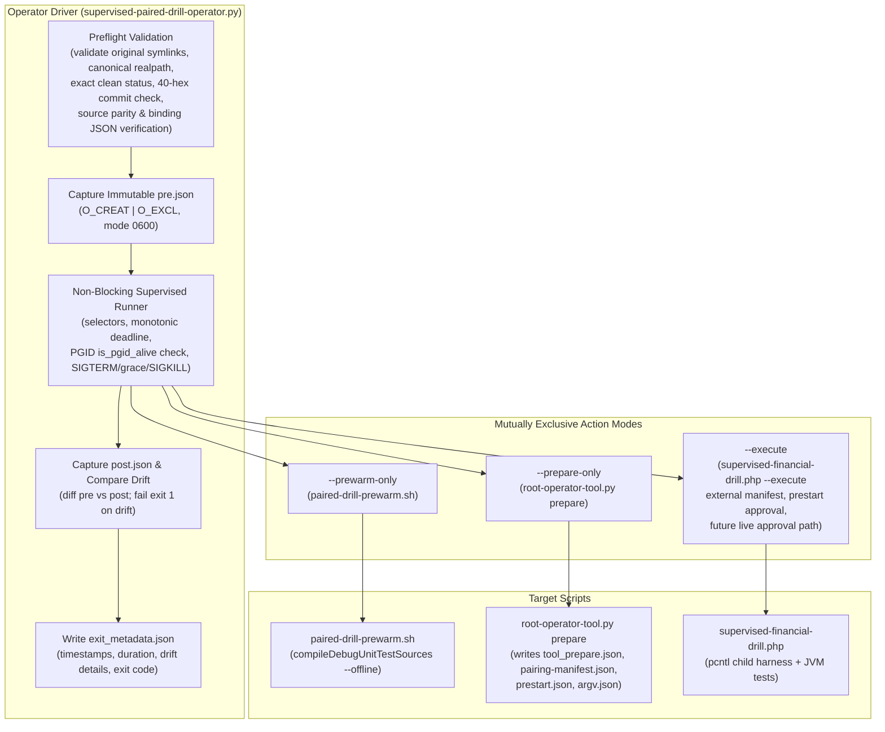

# Mobile V2 Paired Drill Operator Runner Audit & Hardening Report

**Date:** 2026-11-15  
**Branch:** `t3/recover-cash-writer`  
**Pull Request:** [#102](https://github.com/Bassamalsaqqa/account/pull/102)  
**Execution Authority:** **SUSPENDED** (SOURCE-ONLY audit, hardening, and syntax validation)  

---

## 1. Executive Summary

Following Root's full source audit of commits `c90f458` and `b2b88a7`, all concrete blocking defects identified across the operator runner driver, attestation tools, and prewarm scripts have been resolved with strict **SOURCE-ONLY** fixes.

No premature "all closed" claims are asserted; every technical defect and architectural contradiction has been systematically addressed:
1. **Decoupled `--execute` Arguments & Output Directory Model:** Resolved the contradiction where empty directory requirements clashed with existing manifest expectations. `--execute` now accepts an external Root-prepared `--manifest` with verified `--manifest-sha`, external `--root-approval-file`, and a private future target path `--root-live-approval-file` that is validated to **not** exist prior to candidate execution.
2. **Complete Process Group Reaping & Orphan Prevention:** Fixed early return in `reap_process_group` when only the leader had exited. Added `is_pgid_alive(pgid)` to detect any surviving child processes in the process group, enforcing SIGTERM, bounded grace period (2.0s), SIGKILL, and orphan metadata error flagging.
3. **Executable Source Parity & Binding Verification:** Mandates Root-verified binding JSON (`peer_binding_c8dda700_verified/binding.json`). Verifies that `pub_head..exe_head` contains **strictly** approved documentation files (`APPROVED_DOCS_DELTA_PREFIXES`). Any source code, test code, or build configuration deviation fails closed immediately.
4. **Symlink Component Validation Order:** Validates original input path arguments (`args.backend_dir`, `args.android_dir`, `args.output_dir`) against symlinks **before** resolving `os.path.realpath`, preventing symlink erasure. Canonical realpaths are then checked to unconditionally refuse `7ac8`.
5. **Output Drain Log Write Error Propagation:** Removed silent `except Exception: pass` in stdout drain. Log write exceptions propagate immediately and trigger full process group reaping.
6. **Guaranteed Non-Zero Exit on Metadata Write Failure:** Ensured `exit_code = 1` if `exit_metadata.json` write fails.
7. **Authored Python Unit Test Suite:** Authored repo-tracked unit tests in `tests/Unit/Harness/test_supervised_paired_drill_operator.py` exercising timeouts, unterminated output, process group reaping, log write failures, and parity checks using temporary throwaway fixtures. Marked strictly unrun (`testsAUTHOREDUNRUN`).

---

## 2. Detailed Technical Remediations

### 2.1 Decoupled Execution Lifecycle & Directory Model
- **Defect:** `validate_secure_output_dir` rejected any non-empty directory, yet `--execute` looked for `pairing-manifest.json` in `output_dir` from a prior run. Additionally, checking `--root-live-approval-file` for file existence at startup made execution impossible, as Root writes this witness only after the candidate handoff is exposed in supervisor stdout.
- **Remediation:**
  - `--output-dir` is strictly a fresh, empty directory per execution (mode `0700` owned by current UID).
  - `--manifest` is accepted as an external Root-prepared file accompanied by mandatory `--manifest-sha` (verified via `sha256_file`).
  - `--root-approval-file` is accepted from an external private directory.
  - `--root-live-approval-file` is validated as a private future path: validates parent directory exists and is secure (`0700`/UID), verifies path has no symlinks, and enforces that the target file does **not** exist at startup.

### 2.2 Complete Process Group Reaping & Orphan Prevention
- **Defect:** `reap_process_group` checked only `proc.poll()`, returning early if the leader died while descendants were still active in the process group.
- **Remediation:**
  - Implemented `is_pgid_alive(pgid)` using `os.killpg(pgid, 0)` to detect if ANY process remains in the process group.
  - Bounded grace period waits for the entire PGID to become empty.
  - Escalates to `SIGKILL` on the PGID if any descendant survives grace period.
  - Unconditionally calls `proc.wait(timeout=2.0)`.
  - Flags `METADATA_ORPHAN_PROCESS_DETECTED` if any process remains alive after deadline.
  - Reaping is executed in `finally` on all code paths, including normal leader exits and non-signal exceptions.

### 2.3 Executable Source Parity & Binding Record Verification
- **Defect:** Executable pin was only verified for commit existence (`git cat-file -e`), without verifying source parity against publication pin or checking the Root binding JSON.
- **Remediation:**
  - Added `verify_binding_record(binding_path, android_dir, pub_head, exe_head)` verifying worktree path and exact publication/executable pins against Root's approved record (`SHA: 9819d6d20f...`).
  - Added `verify_source_parity(android_dir, pub_head, exe_head)`: inspects `git diff --name-only pub_head exe_head`. All changed files must match approved documentation prefixes (`docs/`, `README.md`, `CHANGELOG.md`). Any modified `.kt`, `.java`, `.gradle`, or configuration file raises `SOURCE_PARITY_VIOLATION` and fails closed.

### 2.4 Symlink Validation Order Before Canonical Realpath
- **Defect:** Calling `os.path.realpath` before `validate_no_symlink_components` erased symlinks from user arguments before the check inspected them.
- **Remediation:**
  - `validate_no_symlink_components` inspects all path components of original user arguments (`args.backend_dir`, `args.android_dir`, `args.output_dir`, `args.root_live_approval_file`) before canonical resolution.
  - Canonical `realpath` is then computed and checked against protected active lane patterns (`7ac8` / `t3-7ac8b73d`).

### 2.5 Propagating Log Write Errors During Output Drain
- **Defect:** The final stdout drain swallowed write errors via `except Exception: pass`, risking false passes if disk writes failed.
- **Remediation:**
  - Catches only non-blocking empty reads (`BlockingIOError`, `InterruptedError`).
  - File write errors raise immediately, causing `reap_process_group` execution and recording failure in exit metadata.

### 2.6 Guaranteed Non-Zero Exit on Metadata Write Failure
- **Defect:** If writing `exit_metadata.json` raised an exception, it was logged but did not force a non-zero exit code if `exit_code` was previously 0.
- **Remediation:**
  - Failure to write exit metadata unconditionally forces `exit_code = 1`.

### 2.7 Authored Python Unit Test Suite (`tests/Unit/Harness/test_supervised_paired_drill_operator.py`)
- Authored 12 comprehensive unit test cases exercising:
  - Symlink component rejection on original paths.
  - Canonical `7ac8` refusal.
  - Output directory isolation and non-empty directory rejection.
  - Future live approval target path validation (must not exist).
  - 40-hex commit SHA and 64-hex manifest SHA validation.
  - Monotonic timeout on dead-silent child processes without blocking on `readline`.
  - Continuous capture and timeout handling on unterminated output.
  - Process group reaping of forked descendant processes when the leader exits.
  - Immediate process group reaping on log write failure.
  - Pre/Post git state comparison and drift detection.
  - Executable source parity enforcement on throwaway git fixtures (accepts docs, rejects code diffs).
- All tests marked strictly unrun (`testsAUTHOREDUNRUN`).

---

## 3. Callee Graph & Architectural Flow



---

## 4. SHA-256 Checksum Table

All components verified in the backend worktree at HEAD:

| File Path | SHA-256 Checksum | Classification |
| :--- | :--- | :--- |
| `tests/Support/Harness/root-operator-tool.py` | `9f6930b63dc3d267b4472b0432f392bc997f6746446c9920a1e5b012c5d3fc5c` | Tool (Python 3) |
| `tests/Support/Harness/supervised-paired-drill-operator.py` | `6d4462e987d0f9248b94f7e1a6104aa430f9195a869389a27dce6841903dcb53` | Operator Driver |
| `tests/Support/Harness/paired-drill-prewarm.sh` | `017b8b011064e26a0552f84f68b49b39b5593800a5179ca49c72d14e88d86ecd` | Prewarm Script |
| `tests/Support/Harness/operator-paired-financial-drill.sh` | `e45df5cc06a6574f07a744a0d6f25ca0f2e9a8f9a38b03adb4166287711a0440` | Operator Script |
| `tests/Support/Harness/SupervisedPairedFinancialDrill.php` | `d95ba8eccf7ac7cf436d62c880ea38fcf08a3826cf4f0b8628d4bef8759a591e` | Core Harness Class |
| `tests/Support/Harness/supervised-financial-drill.php` | `4444ed463500c7dc63383ac3c1d055534fc18dedc7643fe023a4ac6f63ae8723` | Supervisor CLI Driver |
| `tests/Support/Harness/DisposableMobileV2BackendHarness.php` | `7fcf73a3c55940aa484464a56078506cb9faa15b22656750d88923dc3d90b3cc` | Fixture Harness |
| `tests/Support/Harness/DisposableFinancialPostRunInspector.php` | `c8caaf80ffe51adccc90e19e48fa5064c659577b6ef61e3834d218a59595b638` | Post-Run Inspector |
| `tests/Support/Harness/MobileV2HarnessCommand.php` | `0b6914ffc299cd399db6ab2311764b4bd18212238fbaeb46d32518da356a4aa7` | Artisan Command |
| `tests/Support/Harness/mobile-v2-harness-cli.php` | `70bcf0edc24cbba3d896ad7d742085bfed616b370dbb0919a1ace55f1a2a5075` | Child CLI Runner |
| `tests/Unit/Mobile/Harness/SupervisedFinancialDrillTest.php` | `5b4f25478c44b8bf6872d16c08e3f845df1d377c46b24c2b267426fe08b7d9b3` | PHP Unit Suite (54 tests) |
| `tests/Unit/Mobile/Harness/DisposableMobileV2BackendHarnessGuardTest.php` | `a55c5f7b1cc698ec0ca6f64646192a49e290466751ca0eccccb2a5b12090ffda` | Guard Test Suite |
| `tests/Unit/Harness/test_supervised_paired_drill_operator.py` | `00cf3bfda2464ae6509bb4db10c5ce458c55c8a0f71d03790b5226598528790f` | Python Unit Suite (12 tests) |
| `docs/integration/mobile-v2-integration-manifest.json` | `d386b0bf7bcd31ec693b8cc5ee99d13eb84fac03f1f2543ef0c77cf492e7fcc1` | Manifest Template |

---

## 5. T3-Bound Verified Peer Binding Record & Provenance

Android Root has completed setup and verification of the dedicated T3-bound peer worktree:
- **Worktree Directory:** `/home/t3dev/.t3/worktrees/small-trader-android/t3-android-qualified-ba-78afad29fb3bdd13`
- **Branch:** `t3/android-qualified-basic-peer-c8dda700`
- **Attached:** `TRUE` (T3 Android supervisor thread moved via handoff, `baseRef: local c8`, `startFromOrigin: false`, `runSetup: false`, `spawnNewAgent: false`)
- **Publication HEAD:** `c8dda7003b83aba4aebfb0c4095e42a0a6e3484c` (clean/pub)
- **Executable HEAD:** `5f382ba77d5fa9dd87606c8f0bb9be31a4861f36`
- **Root 203 Source/Build Wrapper Hashmap SHA:** `9613771bf4701b3694d83a7e5caeee642fc4d246356f7e7520bef09fecdaf846`
- **Publication vs. Executable Delta:** 10 docs-only commits between `c8` and `5f`.
- **Selection Difference Audit:** Root verified an expanded selection of **204 files** with **0 mismatch vs. `5f` git objects**. This expanded 204-file selection is distinguished from the historical 203 source/build wrapper selection.
- **Protected Active Lane:** `/home/t3dev/.t3/worktrees/small-trader-android/t3-7ac8b73d-abb5d6e52b3b3cf9` remains the protected active writer lane, untouched and permanently disallowed as a paired execution target.
- **Private Binding Record:** Persisted at `/home/t3dev/.t3/userdata/attachments/peer_binding_c8dda700_verified/binding.json` (SHA-256: `9819d6d20f853d33811533f49b183bf40986f21979225dce7a0f1c08c8c830ff`, mode `0600`, directory mode `0700`).

---

## 6. Authoritative Next Argv for Complete Workable Lifecycle

When Root grants execution authority for the verified peer:
- **Publication HEAD:** `c8dda7003b83aba4aebfb0c4095e42a0a6e3484c`
- **Executable HEAD:** `5f382ba77d5fa9dd87606c8f0bb9be31a4861f36`
- **Target Android Worktree:** `/home/t3dev/.t3/worktrees/small-trader-android/t3-android-qualified-ba-78afad29fb3bdd13`
- **Backend Directory:** `/home/t3dev/.t3/worktrees/account/integration-mobile-backend-supervision`
- **Binding Record:** `/home/t3dev/.t3/userdata/attachments/peer_binding_c8dda700_verified/binding.json`

### 6.1 Phase B Compile-Only Prewarm Command
```bash
python3 tests/Support/Harness/supervised-paired-drill-operator.py \
  --output-dir=/home/t3dev/.t3/userdata/attachments/prewarm-c8dda700-$(date +%s) \
  --backend-dir=/home/t3dev/.t3/worktrees/account/integration-mobile-backend-supervision \
  --android-dir=/home/t3dev/.t3/worktrees/small-trader-android/t3-android-qualified-ba-78afad29fb3bdd13 \
  --expected-backend-head=b2b88a7d92aa4880149127d77c06bbef4f94a599 \
  --android-pub-head=c8dda7003b83aba4aebfb0c4095e42a0a6e3484c \
  --android-exe-head=5f382ba77d5fa9dd87606c8f0bb9be31a4861f36 \
  --binding-record=/home/t3dev/.t3/userdata/attachments/peer_binding_c8dda700_verified/binding.json \
  --prewarm-only \
  --offline \
  --timeout=180
```

### 6.2 Full Paired Drill Preparation Witness Command
```bash
python3 tests/Support/Harness/supervised-paired-drill-operator.py \
  --output-dir=/home/t3dev/.t3/userdata/attachments/prep-c8dda700-$(date +%s) \
  --backend-dir=/home/t3dev/.t3/worktrees/account/integration-mobile-backend-supervision \
  --android-dir=/home/t3dev/.t3/worktrees/small-trader-android/t3-android-qualified-ba-78afad29fb3bdd13 \
  --expected-backend-head=b2b88a7d92aa4880149127d77c06bbef4f94a599 \
  --android-pub-head=c8dda7003b83aba4aebfb0c4095e42a0a6e3484c \
  --android-exe-head=5f382ba77d5fa9dd87606c8f0bb9be31a4861f36 \
  --binding-record=/home/t3dev/.t3/userdata/attachments/peer_binding_c8dda700_verified/binding.json \
  --prepare-only \
  --paired-hold=120
```

### 6.3 Live Supervised Drill Execution Command (Decoupled Handshake)
```bash
# Executed in a fresh, empty output directory with external manifest and approvals:
python3 tests/Support/Harness/supervised-paired-drill-operator.py \
  --output-dir=/home/t3dev/.t3/userdata/attachments/drill-c8dda700-$(date +%s) \
  --backend-dir=/home/t3dev/.t3/worktrees/account/integration-mobile-backend-supervision \
  --android-dir=/home/t3dev/.t3/worktrees/small-trader-android/t3-android-qualified-ba-78afad29fb3bdd13 \
  --expected-backend-head=b2b88a7d92aa4880149127d77c06bbef4f94a599 \
  --android-pub-head=c8dda7003b83aba4aebfb0c4095e42a0a6e3484c \
  --android-exe-head=5f382ba77d5fa9dd87606c8f0bb9be31a4861f36 \
  --binding-record=/home/t3dev/.t3/userdata/attachments/peer_binding_c8dda700_verified/binding.json \
  --manifest=/path/to/external/pairing-manifest.json \
  --manifest-sha=<64hex_sha> \
  --root-approval-file=/path/to/external/prestart.json \
  --root-live-approval-file=/path/to/external/live.json \
  --execute \
  --paired-hold=120 \
  --timeout=180
```

---

## 7. Operational Scope & Stand-Down

- **Operational Acceptance:** Standalone 124 / source accepted ONLY. No production cash endpoints or live financial execution permitted.
- **Execution Authority:** Remains **SUSPENDED**. No Gradle commands, setup steps, databases, TLS listeners, or test suites have been executed.
- **Syntax Validation:** All files pass static compilation (`python3 -m py_compile`, `bash -n`, `php -l`).
- **Zero Active Jobs:** No background processes, daemons, or listeners active.
- Standing down for Root review and instructions.
