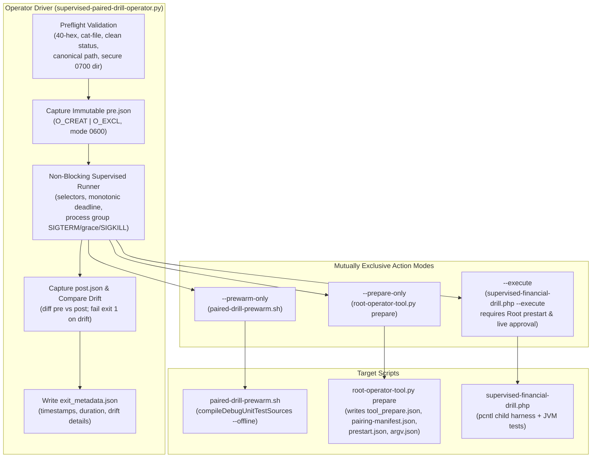

# Mobile V2 Paired Drill Operator Runner Audit & Hardening Report

**Date:** 2026-11-15  
**Branch:** `t3/recover-cash-writer`  
**Pull Request:** [#102](https://github.com/Bassamalsaqqa/account/pull/102)  
**Execution Authority:** **SUSPENDED** (SOURCE-ONLY audit, hardening, and syntax validation)  

---

## 1. Executive Summary

Following Root's full source audit of commit `c90f458`, all 8 concrete blocking defects identified in the operator runner scripts, attestation helpers, and prewarm scripts have been resolved.

All remediations are strictly **SOURCE-ONLY**:
- Non-blocking I/O via Python `selectors` eliminates deadline hangs on silent or unterminated child output; process group reaping bounded with a 2.0s grace period followed by `SIGKILL`.
- Canonical output directory verification strictly enforces `0700` UID ownership, rejects any symlink path component, mandates an external location relative to checkouts, and refuses existing non-empty directories.
- Canonical realpath validation unconditionally rejects active development lanes (`*7ac8*` / `t3-7ac8b73d`).
- Exact clean initial status (`git status --porcelain` empty) is enforced on both repositories; untracked file creation during prewarm is strictly restricted to owned Gradle build directories.
- Full 40-hex lowercase regex validation, commit object existence checks (`git cat-file -e`), and mandatory expected backend HEAD pin enforcement.
- Automated pre/post git state comparison: any detected drift on tracked files or HEAD fails non-zero (`exit 1`); comprehensive exit metadata (`exit_metadata.json`) recorded across all paths.
- Initial `pre.json` is immutable: `root-operator-tool.py prepare` writes a distinct `tool_prepare.json` witness when `pre.json` exists.
- Operator driver execution mode is truthful and unambiguous: explicit `--prewarm-only`, `--prepare-only`, or `--execute` (requiring separate external Root approval files; zero self-approval).

Unit test coverage in `tests/Unit/Mobile/Harness/SupervisedFinancialDrillTest.php` was expanded to **54 tests** verifying all new adversarial constraints. All authored tests remain **strictly unrun** (`testsAUTHOREDUNRUN`) pending explicit QA grant.

---

## 2. Comprehensive Resolution of Concrete Blocking Defects

### 2.1 Defect 1: Non-Blocking I/O & Bounded Process Group Reaping
- **Root Audit Finding:** `proc.stdout.readline()` blocked until a newline was received; if the child was silent or emitted unterminated output, the deadline check was never reached. `proc.wait()` was unbounded.
- **Remediation:**
  - Implemented `selectors.DefaultSelector()` with non-blocking child stdout (`os.set_blocking(fd, False)`).
  - Loop checks monotonic deadline (`time.monotonic()`) continuously with `select(timeout=min(rem, 0.2))`.
  - Process group termination sends `SIGTERM` to `os.killpg`, waits with a bounded grace period (2.0s), escalates to `SIGKILL`, and performs a bounded `proc.wait(timeout=2.0)`.
  - Exception and signal handlers guarantee the child process group is reaped and waited on even if log writes fail.

### 2.2 Defect 2: Output Directory Canonical Verification & Overwrite Refusal
- **Root Audit Finding:** `os.path.abspath + os.makedirs/chmod` followed symlinks, allowed directories inside repositories, and could overwrite existing audit files.
- **Remediation:**
  - Added `validate_no_symlink_components(path)` checking every path component.
  - Enforced canonical `os.path.realpath` resolution.
  - Verified directory is strictly external to both repository checkouts (`not starts_with`).
  - Required mode `0700` owned by `os.getuid()`.
  - Refuses existing non-empty directories to prevent arbitrary pre/post overwrite.

### 2.3 Defect 3: Canonical Protected Path Refusal
- **Root Audit Finding:** `abspath`/`normpath` could be bypassed via symlinks pointing into `7ac8`.
- **Remediation:**
  - Enforced `validate_no_symlink_components` and `os.path.realpath` across Python, bash, and PHP.
  - Rejects any canonical path containing `7ac8` or `t3-7ac8b73d`.
  - In `SupervisedPairedFinancialDrill::assertNotProtectedWorktree`, added canonical `realpath` inspection.

### 2.4 Defect 4: Initial Clean Parity & Restricted Untracked Allowlist
- **Root Audit Finding:** Driver only checked tracked clean (`diff-index`) and ignored untracked files; bash prewarm used broad globs (`build/*`, `docs/*`) without owned provenance.
- **Remediation:**
  - Enforced `git status --porcelain` must be strictly empty on both repositories before any child process is spawned.
  - In `paired-drill-prewarm.sh`, initial status must be clean; post-compilation untracked files are restricted strictly to owned Gradle directories (`.gradle/*`, `build/*`, `app/build/*`). Any other untracked file halts execution immediately.

### 2.5 Defect 5: 40-Hex Validation, Commit Existence & Expected Backend Pin
- **Root Audit Finding:** Pins were validated only by length (`len == 40`) without hex regex, object existence check, or expected backend HEAD pin.
- **Remediation:**
  - Enforced regex `^[0-9a-f]{40}$` across all commit SHAs.
  - Verified commit existence in git object store via read-only `git cat-file -e <sha>^{commit}` for backend expected HEAD, Android publication HEAD, and Android executable HEAD.
  - Added mandatory `--expected-backend-head=<sha>` argument in operator driver, verifying actual backend HEAD matches.

### 2.6 Defect 6: Pre/Post Drift Comparison & Exit Metadata
- **Root Audit Finding:** Post-execution state was captured but never compared to pre-execution state; post-capture failure only printed a warning and exited 0.
- **Remediation:**
  - Added `compare_git_states(pre, post)` comparing HEAD, status, and tracked file SHA-256 dictionaries for both repositories.
  - Any detected drift fails non-zero (`exit 1`) and logs full drift diff.
  - Post-capture failure unconditionally sets `exit_code = 1`.
  - Always writes `exit_metadata.json` (0600) recording `exit_code`, `duration_seconds`, `pre_post_matched`, `drift_detected`, and `failure_reason`.

### 2.7 Defect 7: Immutable Initial `pre.json`
- **Root Audit Finding:** `root-operator-tool.py prepare` overwrote the driver's initial `pre.json`.
- **Remediation:**
  - Initial `pre.json` created by operator driver with `O_CREAT | O_EXCL` (mode 0600).
  - In `root-operator-tool.py prepare`, if `pre.json` already exists, it writes a distinct witness `tool_prepare.json` (0600) and never overwrites `pre.json`.

### 2.8 Defect 8: Truthful Execution Modes & Arguments
- **Root Audit Finding:** Driver claimed "full prepare + drill" in else-branch but only ran prepare; lacked truthful execution modes.
- **Remediation:**
  - Mutually exclusive explicit mode flags:
    - `--prewarm-only`: Executes compile-only prewarm (`paired-drill-prewarm.sh`).
    - `--prepare-only`: Executes witness preparation (`root-operator-tool.py prepare`).
    - `--execute`: Executes live supervised drill (`supervised-financial-drill.php --execute`) requiring separate external Root approval files (`--root-approval-file` and `--root-live-approval-file`; zero self-approval).
  - Verified `--paired-hold` argument is supported and passed correctly to `root-operator-tool.py`.

---

## 3. Callee Graph & Architectural Flow



---

## 4. SHA-256 Checksum Table

All components verified in the backend worktree at HEAD:

| File Path | SHA-256 Checksum | Classification |
| :--- | :--- | :--- |
| `tests/Support/Harness/root-operator-tool.py` | `944b04e0cf0e82bf7793b2db3a73feb634b3f67c338757aae6765837b1367232` | Tool (Python 3) |
| `tests/Support/Harness/supervised-paired-drill-operator.py` | `cafd019a60918ac832af0bc9af75972edf34ccc81a6af519377d9b3353ce3451` | Operator Driver |
| `tests/Support/Harness/paired-drill-prewarm.sh` | `017b8b011064e26a0552f84f68b49b39b5593800a5179ca49c72d14e88d86ecd` | Prewarm Script |
| `tests/Support/Harness/operator-paired-financial-drill.sh` | `e45df5cc06a6574f07a744a0d6f25ca0f2e9a8f9a38b03adb4166287711a0440` | Operator Script |
| `tests/Support/Harness/SupervisedPairedFinancialDrill.php` | `d95ba8eccf7ac7cf436d62c880ea38fcf08a3826cf4f0b8628d4bef8759a591e` | Core Harness Class |
| `tests/Support/Harness/supervised-financial-drill.php` | `4444ed463500c7dc63383ac3c1d055534fc18dedc7643fe023a4ac6f63ae8723` | Supervisor CLI Driver |
| `tests/Support/Harness/DisposableMobileV2BackendHarness.php` | `7fcf73a3c55940aa484464a56078506cb9faa15b22656750d88923dc3d90b3cc` | Fixture Harness |
| `tests/Support/Harness/DisposableFinancialPostRunInspector.php` | `c8caaf80ffe51adccc90e19e48fa5064c659577b6ef61e3834d218a59595b638` | Post-Run Inspector |
| `tests/Support/Harness/MobileV2HarnessCommand.php` | `0b6914ffc299cd399db6ab2311764b4bd18212238fbaeb46d32518da356a4aa7` | Artisan Command |
| `tests/Support/Harness/mobile-v2-harness-cli.php` | `70bcf0edc24cbba3d896ad7d742085bfed616b370dbb0919a1ace55f1a2a5075` | Child CLI Runner |
| `tests/Unit/Mobile/Harness/SupervisedFinancialDrillTest.php` | `5b4f25478c44b8bf6872d16c08e3f845df1d377c46b24c2b267426fe08b7d9b3` | Unit Test Suite (54 tests) |
| `tests/Unit/Mobile/Harness/DisposableMobileV2BackendHarnessGuardTest.php` | `a55c5f7b1cc698ec0ca6f64646192a49e290466751ca0eccccb2a5b12090ffda` | Guard Test Suite |
| `docs/integration/mobile-v2-integration-manifest.json` | `d386b0bf7bcd31ec693b8cc5ee99d13eb84fac03f1f2543ef0c77cf492e7fcc1` | Manifest Template |

---

## 5. T3-Bound Verified Peer Binding Record & Provenance

Android Root has completed the setup and verification of the dedicated T3-bound peer worktree:
- **Worktree Directory:** `/home/t3dev/.t3/worktrees/small-trader-android/t3-android-qualified-ba-78afad29fb3bdd13`
- **Branch:** `t3/android-qualified-basic-peer-c8dda700`
- **Attached:** `TRUE` (T3 Android supervisor thread moved via handoff, `baseRef: local c8`, `startFromOrigin: false`, `runSetup: false`, `spawnNewAgent: false`)
- **Publication HEAD:** `c8dda7003b83aba4aebfb0c4095e42a0a6e3484c` (clean/pub)
- **Executable HEAD:** `5f382ba77d5fa9dd87606c8f0bb9be31a4861f36`
- **Root 203 Source/Build Wrapper Hashmap SHA:** `9613771bf4701b3694d83a7e5caeee642fc4d246356f7e7520bef09fecdaf846`
- **Publication vs. Executable Delta:** 10 docs-only commits between `c8` and `5f`.
- **Selection Difference Audit:** Root verified an expanded selection of **204 files** with **0 mismatch vs. `5f` git objects**. This expanded 204-file selection is distinguished from the historical 203 source/build wrapper selection.
- **Protected Active Lane:** `/home/t3dev/.t3/worktrees/small-trader-android/t3-7ac8b73d-abb5d6e52b3b3cf9` remains the protected active writer lane, untouched and permanently disallowed as a paired execution target.
- **Private Binding Record:** Persisted at `/home/t3dev/.t3/userdata/attachments/peer_binding_c8dda700_verified/binding.json` (SHA-256: `9819d6d20f853d33811533f49b183bf40986f21979225dce7a0f1c08c8c830ff`, mode `0600`, directory mode `0700`).

---

## 6. Authoritative Next Argv for Verified T3-Bound Peer Pins

When Root grants execution authority for the verified peer:
- **Publication HEAD:** `c8dda7003b83aba4aebfb0c4095e42a0a6e3484c`
- **Executable HEAD:** `5f382ba77d5fa9dd87606c8f0bb9be31a4861f36`
- **Target Android Worktree:** `/home/t3dev/.t3/worktrees/small-trader-android/t3-android-qualified-ba-78afad29fb3bdd13`
- **Backend Directory:** `/home/t3dev/.t3/worktrees/account/integration-mobile-backend-supervision`

### 6.1 Phase B Compile-Only Prewarm Command
```bash
python3 tests/Support/Harness/supervised-paired-drill-operator.py \
  --output-dir=/home/t3dev/.t3/userdata/attachments/prewarm-c8dda700-$(date +%s) \
  --backend-dir=/home/t3dev/.t3/worktrees/account/integration-mobile-backend-supervision \
  --android-dir=/home/t3dev/.t3/worktrees/small-trader-android/t3-android-qualified-ba-78afad29fb3bdd13 \
  --expected-backend-head=c90f4587c41277629370631645eba5c52661ee07 \
  --android-pub-head=c8dda7003b83aba4aebfb0c4095e42a0a6e3484c \
  --android-exe-head=5f382ba77d5fa9dd87606c8f0bb9be31a4861f36 \
  --prewarm-only \
  --offline \
  --timeout=180
```

### 6.2 Full Paired Drill Preparation Command
```bash
python3 tests/Support/Harness/supervised-paired-drill-operator.py \
  --output-dir=/home/t3dev/.t3/userdata/attachments/drill-c8dda700-$(date +%s) \
  --backend-dir=/home/t3dev/.t3/worktrees/account/integration-mobile-backend-supervision \
  --android-dir=/home/t3dev/.t3/worktrees/small-trader-android/t3-android-qualified-ba-78afad29fb3bdd13 \
  --expected-backend-head=c90f4587c41277629370631645eba5c52661ee07 \
  --android-pub-head=c8dda7003b83aba4aebfb0c4095e42a0a6e3484c \
  --android-exe-head=5f382ba77d5fa9dd87606c8f0bb9be31a4861f36 \
  --prepare-only \
  --paired-hold=120
```

---

## 7. Operational Scope & Stand-Down

- **Operational Acceptance:** Standalone 124 / source accepted ONLY. No production cash endpoints or live financial execution permitted.
- **Execution Authority:** Remains **SUSPENDED**. No Gradle commands, setup steps, databases, TLS listeners, or test suites have been executed.
- **Syntax Validation:** All files pass static compilation (`python3 -m py_compile`, `bash -n`, `php -l`).
- **Zero Active Jobs:** No background processes, daemons, or listeners active.
- Standing down for Root review and instructions.
