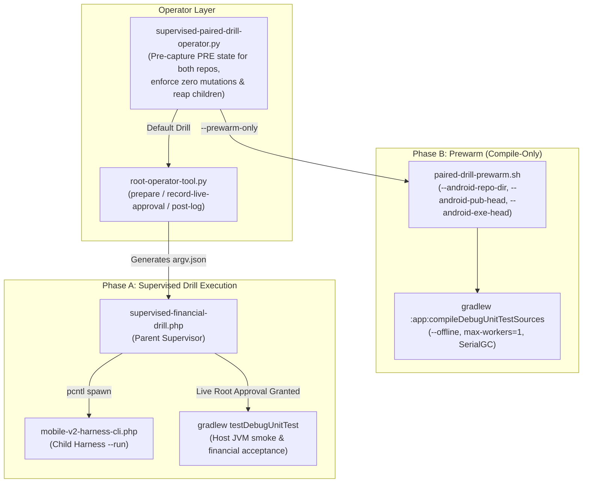

# Mobile V2 Paired Drill Operator Runner Audit & Hardening Report

**Date:** 2026-11-15  
**Branch:** `t3/recover-cash-writer`  
**Pull Request:** [#102](https://github.com/Bassamalsaqqa/account/pull/102)  
**Execution Authority:** **SUSPENDED** (SOURCE-ONLY audit, hardening, and syntax validation)  

---

## 1. Executive Summary

Following Root's suspension of execution authority and directives regarding unauthorized worktree mutations and runner defects, a comprehensive audit and hardening of all operator runner scripts, test harness components, and attestation helpers was conducted.

All ad-hoc scratch scripts have been retired/quarantined and replaced with **ONE repo-tracked, reviewable operator driver** (`tests/Support/Harness/supervised-paired-drill-operator.py`). In addition, the path resolution defect in `tests/Support/Harness/root-operator-tool.py` has been resolved, hardcoded commit pins have been completely eradicated, protected active development lanes are unconditionally refused, and strict dual-repo state capture is enforced before any operations.

Unit test coverage in `tests/Unit/Mobile/Harness/SupervisedFinancialDrillTest.php` was expanded from 45 to 51 tests to verify all new adversarial constraints. All authored tests remain **strictly unrun** (`testsAUTHOREDUNRUN`) pending Root review and explicit QA grant.

---

## 2. Remediations & Technical Invariants

### 2.1 Resolution of `DEFAULT_REPO_DIR` Path Bug in `root-operator-tool.py`
- **Defect:** `DEFAULT_REPO_DIR = os.path.dirname(os.path.dirname(os.path.dirname(os.path.abspath(__file__))))` resolved to `tests/` instead of the repository root, as `__file__` is at depth 3 from root (`tests/Support/Harness/root-operator-tool.py`).
- **Remediation:** Updated to 4 levels of `os.path.dirname` and reinforced with a verified fallback via `git rev-parse --show-toplevel`.

### 2.2 Complete Parameterization of Publication & Executable Pins
- **Defect:** Global constants `PUB_HEAD = 'b0d5965e...'` and `EXE_HEAD = '360ce784...'` were hardcoded in `root-operator-tool.py` and `paired-drill-prewarm.sh`, bypassing CLI overrides and preventing clean updates to new peer pins.
- **Remediation:**
  - Removed all module-level hardcoded pin constants.
  - Parameterized `make_prestart_json`, `make_live_approval_json`, `prepare_manifest`, and `cmd_prepare` with mandatory `pub_head` and `exe_head` arguments.
  - In `cmd_record_live`, publication and executable heads are extracted directly from `prestart.json`.
  - In `paired-drill-prewarm.sh`, `--android-pub-head` and `--android-exe-head` are mandatory.

### 2.3 Protected Active Development Lane Refusal
- **Invariant:** Paired drills and prewarms must NEVER target or touch active writer checkouts (specifically `/home/t3dev/.t3/worktrees/small-trader-android/t3-7ac8b73d-abb5d6e52b3b3cf9` or any path matching `*7ac8*`).
- **Enforcement:**
  - Added `assert_not_protected_worktree(path)` in Python runners (`root-operator-tool.py` and `supervised-paired-drill-operator.py`).
  - Added pattern matching in bash prewarm (`case "${ANDROID_REPO}" in *7ac8*|*t3-7ac8b73d*) ...`).
  - Added public static method `SupervisedPairedFinancialDrill::assertNotProtectedWorktree(string $path)` in PHP harness and enforced it in `supervised-financial-drill.php`.
  - Immediate fail-closed with exit code 1 if a protected path is detected.

### 2.4 Tracked Clean Parity & Untracked Dirty Allowlist
- **Invariant:** Neither repository may have modified tracked files. Any deviation between worktree and HEAD fails closed before any child process is spawned.
- **Enforcement:**
  - Verified via `git diff-index --quiet HEAD --`.
  - For untracked files (`git ls-files --others --exclude-standard`), a strict allowlist is enforced in `paired-drill-prewarm.sh` permitting ONLY owned build and evidence artifacts (`build/*`, `.gradle/*`, `app/build/*`, `docs/integration/v2-online-cash-evidence/*`). Any other untracked file halts execution immediately.

### 2.5 Authoring of Repo-Tracked Operator Driver (`supervised-paired-drill-operator.py`)
- Replaces ad-hoc scratch scripts with a single version-controlled, audited operator tool:
  - **Zero Git Mutations:** Does NOT contain any `git checkout`, `git reset`, `git clean`, or worktree mutation calls.
  - **Initial PRE State Capture:** Captures `git rev-parse HEAD`, `git status --porcelain`, and `git ls-files` SHA-256 for BOTH repositories into `pre.json` (0600) BEFORE executing any actions.
  - **Child Supervision & Process Tree Reaping:** Executes child processes in dedicated process groups (`start_new_session=True`). On timeout or signal (`SIGINT`/`SIGTERM`), signals the entire process group (`os.killpg`) to ensure no orphan Gradle daemons or PHP processes survive.
  - **Always-Captured POST State:** Captures complete `post.json` (0600) for both repositories in all exit paths (success, error, or signal).
  - **External Private Logging:** All output is tee'd to `operator_execution.log` (0600) inside `--output-dir` (0700).

---

## 3. Callee Graph & Architectural Flow



---

## 4. SHA-256 Checksum Table

All components verified in the backend worktree at HEAD:

| File Path | SHA-256 Checksum | Classification |
| :--- | :--- | :--- |
| `tests/Support/Harness/root-operator-tool.py` | `51438f2b129cfc39f16386d9d7fcc390df168ed8161447ca097865fa4f9aab5d` | Tool (Python 3) |
| `tests/Support/Harness/supervised-paired-drill-operator.py` | `c4ff525af2a6f3f5bb02f9e9a66bf462d83b6b84af828809d50c8ec6fb850b54` | Operator Driver |
| `tests/Support/Harness/paired-drill-prewarm.sh` | `1052075f8cc5aa0a8a5770fc46e189c294f1d16c4079daaa915c1763d182a901` | Prewarm Script |
| `tests/Support/Harness/operator-paired-financial-drill.sh` | `e45df5cc06a6574f07a744a0d6f25ca0f2e9a8f9a38b03adb4166287711a0440` | Operator Script |
| `tests/Support/Harness/SupervisedPairedFinancialDrill.php` | `64eabc0692273c99978dbe2a8aa307c73df0a1661077eea5f77fadee1d13f3f2` | Core Harness Class |
| `tests/Support/Harness/supervised-financial-drill.php` | `4444ed463500c7dc63383ac3c1d055534fc18dedc7643fe023a4ac6f63ae8723` | Supervisor CLI Driver |
| `tests/Support/Harness/DisposableMobileV2BackendHarness.php` | `7fcf73a3c55940aa484464a56078506cb9faa15b22656750d88923dc3d90b3cc` | Fixture Harness |
| `tests/Support/Harness/DisposableFinancialPostRunInspector.php` | `c8caaf80ffe51adccc90e19e48fa5064c659577b6ef61e3834d218a59595b638` | Post-Run Inspector |
| `tests/Support/Harness/MobileV2HarnessCommand.php` | `0b6914ffc299cd399db6ab2311764b4bd18212238fbaeb46d32518da356a4aa7` | Artisan Command |
| `tests/Support/Harness/mobile-v2-harness-cli.php` | `70bcf0edc24cbba3d896ad7d742085bfed616b370dbb0919a1ace55f1a2a5075` | Child CLI Runner |
| `tests/Unit/Mobile/Harness/SupervisedFinancialDrillTest.php` | `3c89a16ca33f4a06ad4cebba307e71584fedd258f4d32f400eb8c18fe1d4714b` | Unit Test Suite (51 tests) |
| `tests/Unit/Mobile/Harness/DisposableMobileV2BackendHarnessGuardTest.php` | `a55c5f7b1cc698ec0ca6f64646192a49e290466751ca0eccccb2a5b12090ffda` | Guard Test Suite |
| `docs/integration/mobile-v2-integration-manifest.json` | `d386b0bf7bcd31ec693b8cc5ee99d13eb84fac03f1f2543ef0c77cf492e7fcc1` | Manifest Template |

---

## 5. Historical Untracked File Status & Disclaimer

As observed by Root during reflog analysis, all 203 tracked source and build files at `a29` commit object match Root-observed tree hash `6173250b9c5f29a3d26c87e99830588dd48c8aee8ab0dbc8956bcd8aa923a1c9`. Furthermore, git commit objects `a29a10d`, `4a59258`, and `fd26808` are confirmed intact in the Android repository object store.

**Disclaimer Regarding Historical Untracked Loss:**  
While tracked git object integrity is fully proven, whether any untracked or uncommitted work in the Android repository was affected during the historical unauthorized checkout prior to PRE attestation cannot be proven retrospectively. The presence of untracked directories (such as `attempt-1/` and user asset slices) proves that untracked directories were not universally obliterated, but does NOT constitute proof of zero historical untracked file loss.

All operator tools now strictly forbid any command that could mutate worktree files or checkouts.

---

## 6. Authoritative Next Argv for New Accepted Peer Pins

When Root approves paired execution with the new accepted peer pins:
- **Accepted Publication HEAD:** `c8dda7003b83aba4aebfb0c4095e42a0a6e3484c`
- **Accepted Executable HEAD:** `5f382ba77d5fa9dd87606c8f0bb9be31a4861f36`
- **Target Android Worktree:** An isolated, non-`7ac8` worktree approved by Root (e.g. `/home/t3dev/.t3/worktrees/small-trader-android/t3-c8dda700-isolated`)

### 6.1 Phase B Compile-Only Prewarm Command
```bash
python3 tests/Support/Harness/supervised-paired-drill-operator.py \
  --output-dir=/home/t3dev/.t3/userdata/attachments/prewarm-c8dda700-$(date +%s) \
  --backend-dir=/home/t3dev/.t3/worktrees/account/integration-mobile-backend-supervision \
  --android-dir=/path/to/isolated/android-c8dda700 \
  --android-pub-head=c8dda7003b83aba4aebfb0c4095e42a0a6e3484c \
  --android-exe-head=5f382ba77d5fa9dd87606c8f0bb9be31a4861f36 \
  --prewarm-only \
  --offline \
  --timeout=180
```

### 6.2 Full Paired Drill Preparation Command
```bash
python3 tests/Support/Harness/root-operator-tool.py prepare \
  --repo-dir=/home/t3dev/.t3/worktrees/account/integration-mobile-backend-supervision \
  --android-dir=/path/to/isolated/android-c8dda700 \
  --android-pub-head=c8dda7003b83aba4aebfb0c4095e42a0a6e3484c \
  --android-exe-head=5f382ba77d5fa9dd87606c8f0bb9be31a4861f36 \
  --output-dir=/home/t3dev/.t3/userdata/attachments/drill-c8dda700-$(date +%s) \
  --paired-hold=120
```

---

## 7. Status & Stand-Down

- All syntax checks pass (`python3 -m py_compile`, `bash -n`, `php -l`).
- Zero background jobs, daemons, or listeners active.
- Execution authority remains **SUSPENDED**.
- Standing down for Root review and instructions.
